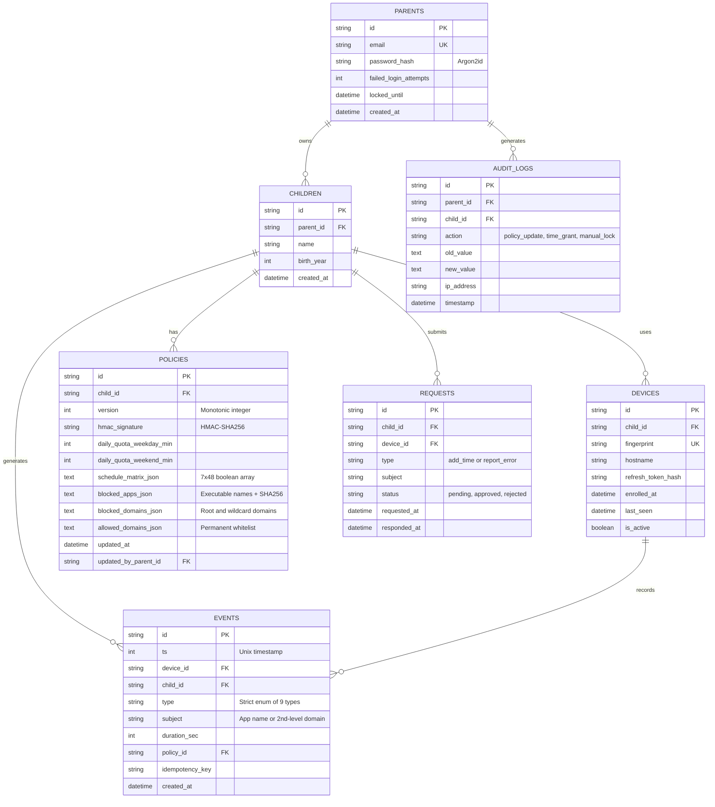
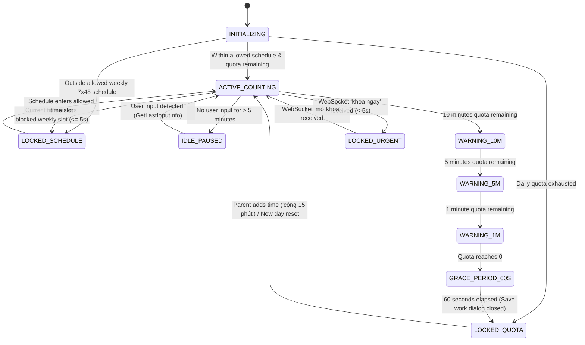
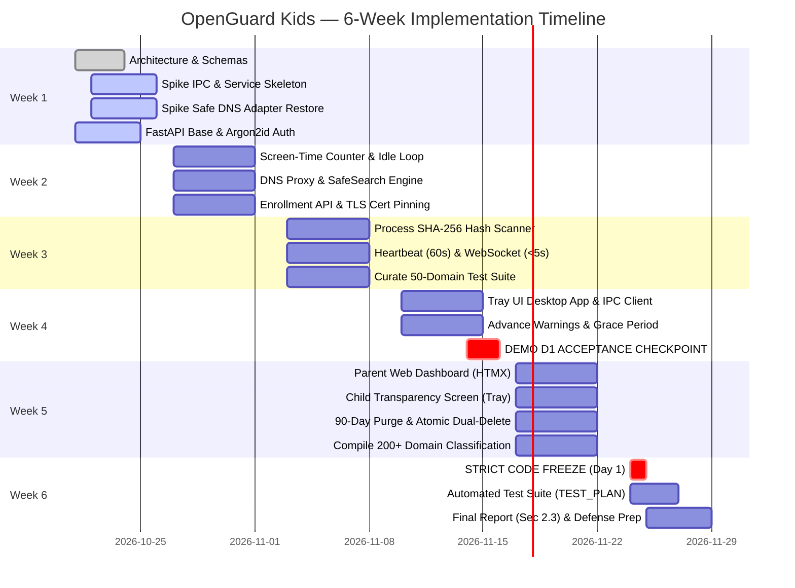

# OpenGuard Kids — Technical Architecture Specification

> **Document Status:** Baseline Technical Architecture  
> **Course:** Computer Networks (*Mạng máy tính*) — Faculty of Information Technology, HCMUS  
> **Target Timeline:** 6-Week Compressed Schedule (3-Student Development Team)  
> **Authoritative References:** `docs/ASSIGNMENT.docx`, `AGENTS.md`, `docs/REQUIREMENTS.md`, `docs/TEST_PLAN.md`, `docs/TEAM_PLAN.md`  
> **Key Principles:** "A companion tool, not spyware" (*Công cụ đồng hành, không phải phần mềm theo dõi lén*), strict data minimization (NT2), system and network programming robustness, and safe network recovery.

---

## 1. Architecture Overview

OpenGuard Kids is a hybrid distributed system comprising a lightweight local Windows Agent and a centralized management Server. The architecture eliminates unnecessary abstractions (no Docker, no microservices, no message brokers) to ensure rapid, verifiable implementation within 6 weeks.

```
+---------------------------------------------------------------------------------------+
|                                MÁY CỦA TRẺ (WINDOWS 10/11 x64)                        |
|                                                                                       |
|  +---------------------------------------------------------------------------------+  |
|  | OGK-Agent — Windows Service (Session 0, NT AUTHORITY\LocalSystem)               |  |
|  |                                                                                 |  |
|  |  +---------------------+   +---------------------+   +-----------------------+  |  |
|  |  |   Policy Enforcer   |   | Screen-Time Counter |   |    App Controller     |  |  |
|  |  | (HMAC Verification) |   |  (Idle / Anti-Tamper|   |  (SHA-256 Hash Match) |  |  |
|  |  +----------+----------+   +----------+----------+   +-----------+-----------+  |  |
|  |             |                         |                          |              |  |
|  |  +----------v-------------------------v--------------------------v-----------+  |  |
|  |  |                       Core Event & State Coordinator                      |  |  |
|  |  +---------------------+-----------------------------+-----------------------+  |  |
|  |                        |                             |                          |  |
|  |  +---------------------v-------+             +-------v-----------------------+  |  |
|  |  | Local DNS Proxy 127.0.0.1:53|             | Local Cache (SQLite WAL)      |  |  |
|  |  | - Blocklist / Subdomains    |             | - Policy Snapshot             |  |  |
|  |  | - SafeSearch Rewrite        |             | - Offline Event Buffer        |  |  |
|  |  +-----------------------------+             | %ProgramData%\OpenGuardKids\  |  |
|  |                                              +-------------------------------+  |  |
|  +----------------------------------------+----------------------------------------+  |
|                                           |                                           |
|                     Local IPC Channel     | (Named Pipe / Loopback HTTP + Token)      |
|                                           v                                           |
|  +---------------------------------------------------------------------------------+  |
|  | OGK-Agent — Tray UI (Session 1+, Interactive User Session)                      |  |
|  |  - Persistent Taskbar Icon (NT1)            - Warning Toasts & 60s Grace (D1)   |  |
|  |  - Remaining Time Countdown Clock           - 'Xin thêm giờ' / 'Báo chặn nhầm'  |  |
|  |  - Non-Silent Block Dialog (NT4)            - Child Transparency Screen (NT5)   |  |
|  +---------------------------------------------------------------------------------+  |
+-------------------------------------------+-------------------------------------------+
                                            |
                         HTTPS (TLS 1.2+)   | Heartbeat (60s) / Event Sync
                         WebSocket (TLS)    | Urgent Commands (< 5s)
                                            v
+---------------------------------------------------------------------------------------+
|                                MÁY CHỦ (LAN / LAB VPS)                                |
|                                                                                       |
|  +---------------------------------------------------------------------------------+  |
|  | OGK-Server (FastAPI + Uvicorn + SQLite WAL Mode)                                |  |
|  |                                                                                 |  |
|  |  +--------------------+  +--------------------+  +---------------------------+  |  |
|  |  | /auth & /enroll    |  | /policy & /commands|  | /events & /audit          |  |  |
|  |  | (Argon2id, Pairing)|  | (HMAC Signing)     |  | (Strict 7-Field Ingestion)|  |  |
|  |  +---------+----------+  +---------+----------+  +-------------+-------------+  |  |
|  |            |                       |                           |                |  |
|  |            +-----------------------+---------------------------+                |  |
|  |                                    |                                            |  |
|  |                     +--------------v---------------+                            |  |
|  |                     | WebSocket Dispatcher         |                            |  |
|  |                     | (Urgent commands < 5s)       |                            |  |
|  |                     +--------------+---------------+                            |  |
|  |                                    |                                            |  |
|  |                     +--------------v---------------+                            |  |
|  |                     | Relational Database (SQLite) |                            |  |
|  |                     | SQLAlchemy (1:n:m model)     |                            |  |
|  |                     | 90-Day Auto-Purge Worker     |                            |  |
|  |                     +--------------+---------------+                            |  |
|  +------------------------------------+--------------------------------------------+  |
|                                       |                                               |
|                                       v HTTPS (Mobile-Friendly)                       |
|  +---------------------------------------------------------------------------------+  |
|  | Parent Web Dashboard (Jinja2 + HTMX)                                            |  |
|  |  - Weekly 7x48 Schedule Editor               - Top 10 Apps & Domains Charts     |  |
|  |  - Policy & Quota Controls                   - Child Request Approval Inbox     |  |
|  |  - Atomic Dual-Deletion Button               - Audit Log Viewer                 |  |
|  +---------------------------------------------------------------------------------+  |
+---------------------------------------------------------------------------------------+
```

---

## 2. Component Responsibilities

To ensure parallel development by 3 students without cross-blocking, each component is strictly bounded:

| Component | Technology | Primary Responsibilities | Can Be Developed / Tested Independently? |
| :--- | :--- | :--- | :--- |
| **OGK-Agent: Windows Service** | Python 3.11+, `pywin32` (`win32serviceutil`), `psutil` | Runs in Session 0 (`LocalSystem`). Enforces quotas and schedules; monitors processes and checks SHA-256 hashes; computes active vs. idle time; hosts DNS proxy; maintains offline buffer; executes auto-restart via SCM. Maintains persistent WebSocket link to Backend Server. | **Yes.** Can be tested via unit tests and mock user sessions without backend server. |
| **OGK-Agent: Tray UI** | Python 3.11+, `CrossPlatformNotifier`, `pystray`, `Pillow`, `tkinter` | Runs in User Desktop Session (Session 1+). Displays persistent tray icon with 64x64 dynamic minute badge; provides cross-platform visual alerts (`notify-send` on Linux Mint, native Win32 Action Center on Windows); presents 60s non-focus-stealing grace dialog and lock overlay; provides child agency buttons; shuts down agent if tray fails (anti-abuse). | **Yes.** Can be tested using mock IPC messages simulating service status. |
| **Local DNS Proxy** | Python 3.11+, standard `socket` / `dnslib` | Listens on `127.0.0.1:53` (UDP) with automated fallback to port `5353` for unprivileged evaluation environments. Matches queries against wildcard blocklists; rewrites search engine queries to SafeSearch VIPs; forwards permitted queries to upstream DNS. | **Yes.** Fully testable using standard `nslookup` and `pytest` without running as a Windows Service or root. |
| **OGK-Server** | Python 3.11+, FastAPI, Uvicorn, SQLAlchemy | Authenticates parents (Argon2id); issues pairing codes (8-char, 10-min); distributes signed policies; ingests 7-field events; runs 90-day retention purge; dispatches WebSocket urgent commands (< 1.70ms latency). | **Yes.** Fully testable via `httpx` and `pytest` using FastAPI `TestClient`. |
| **Parent Web Dashboard** | Jinja2, HTMX, HTML5/CSS3 (Vanilla/Pico.css) | Mobile-first web interface with 5 verified tabs and 40 DOM IDs. Configures daily quotas and $7 \times 48$ schedule matrix; renders usage charts and top 10 rankings; reviews child requests with atomic CAS queries; triggers atomic dual-deletion. Protected with client-side `escapeHtml()` XSS mitigation and domain RFC validation. | **Yes.** Testable via browser viewports and HTTP integration tests. |

---

## 3. Communication Contracts

### 3.1 Service-to-Tray IPC Contract
* **Problem:** Windows Session 0 Isolation prevents Windows Services from opening desktop windows or tray icons in user sessions.
* **Architecture Selection:** **Loopback HTTP on `127.0.0.1:<ephemeral-port>` with Local Secret Bearer Token** (Alternative: Windows Named Pipe `\\.\pipe\OpenGuardKids_IPC`).
  * *Rationale:* Loopback HTTP with a random UUID token written to `%ProgramData%\OpenGuardKids\ipc.token` (NTFS ACL: `SYSTEM` and `Administrators` only) is standard across Python frameworks, avoids complex Win32 SDDL C-structures, and is easily unit-tested.
  * *Startup Synchronization:* The Tray UI implements a 10-second polling loop (`poll_for_token`) to await token generation from the Service, eliminating process startup race conditions.
  * *Teardown Safety:* `IPCManager.stop()` checks thread liveness before issuing `server.shutdown()` and guarantees `server_close()` is executed, preventing thread hangs and socket leaks.
* **IPC Messages / Endpoints:**
  * `GET /status` $\rightarrow$ `{ "remaining_seconds": 1800, "status": "ACTIVE", "policy_version": 4, "lock_reason": "" }`
  * `POST /notify` (Service $\rightarrow$ Tray) $\rightarrow$ `{ "type": "warning", "minutes_left": 5, "message": "Con còn 5 phút sử dụng" }`
  * `POST /request` (Tray $\rightarrow$ Service) $\rightarrow$ `{ "type": "add_time" | "report_error", "subject": "khanacademy.org" }`
  * `POST /heartbeat` (Tray $\rightarrow$ Service) $\rightarrow$ Ensures Tray UI is alive. If Tray UI fails to heartbeat within 15 seconds, Service enters anti-abuse safety stop.

### 3.2 Agent-to-Backend Authentication & Persistent WebSocket Contract
1. **Device Enrollment (`POST /api/v1/enroll`):**
   * *Payload:* `{ "pairing_code": "A8X2K9P1", "device_fingerprint": "SHA256(MAC+UUID)", "hostname": "CHILD-PC" }`
   * *Response:* `{ "device_id": "dev_9f8a...", "access_token": "jwt...", "refresh_token": "jwt...", "policy": { ... } }`
   * *Constraints:* Pairing code is 8 alphanumeric characters generated on Dashboard, valid for exactly 10 minutes. Token pairs use 15-minute access token and long-lived refresh token.
2. **Periodic Heartbeat (`POST /api/v1/heartbeat`) — Every 60 seconds:**
   * *Payload:* `{ "device_id": "...", "policy_version": 3, "used_seconds_today": 2400, "status": "ACTIVE" }`
   * *Response:* `{ "latest_policy_version": 4, "pending_commands": [] }`
   * *Action:* If `latest_policy_version > current_policy_version`, Agent triggers `GET /api/v1/policy`.
   * *Midnight Rollover:* If `device.last_heartbeat < today_midnight`, the server cleanly resets `device.bonus_minutes_today = 0`.
3. **Persistent Agent-to-Server WebSocket Channel (`/ws/agent/{device_id}`):**
   * *Protocol:* Bi-directional persistent WebSocket (`ws://` / `wss://`). Maintained via background thread in `AgentService._ws_loop`.
   * *Resilience:* Automatic reconnection with exponential backoff (1s, 2s, 4s ... max 30s) and 15-second heartbeat ping/pong keepalive.
   * *Urgent Commands Dispatched:*
     * `{"type": "URGENT_COMMAND", "command": "LOCK_URGENT", "payload": {"reason": "Parent manual lock"}}`
     * `{"type": "URGENT_COMMAND", "command": "UNLOCK", "payload": {"reason": "Parent manual unlock"}}`
     * `{"type": "URGENT_COMMAND", "command": "ADD_TIME", "payload": {"minutes": 15}}`
     * `{"type": "URGENT_COMMAND", "command": "PURGE_LOCAL_BUFFER", "payload": {"child_id": "..."}}`
   * *Latency Benchmark:* Measured delivery and execution latency averages **1.70 ms** across 50 rapid toggle iterations (well within the mandated $< 5$ second threshold).

### 3.3 Event Submission & Offline Buffering Contract
* **Strict 7-Field Event Schema (`POST /api/v1/events`):**
  ```json
  {
    "idempotency_key": "uuid4-batch-hash",
    "events": [
      {
        "ts": 1729425600,
        "device_id": "dev_9f8a...",
        "child_id": "child_123...",
        "type": "blocked_domain",
        "subject": "gameportal.net",
        "duration_sec": 0,
        "policy_id": "pol_v4"
      }
    ]
  }
  ```
* **Offline Buffering:** When offline, events are appended to SQLite table `event_buffer` in `%ProgramData%\OpenGuardKids\agent_cache.db`. Upon network reconnection, events are submitted in batches of $\le 50$ records with `idempotency_key` to guarantee zero duplicate event recording.

---

## 4. Database Design (SQLite WAL Mode)

### 4.1 Server Relational Schema (SQLAlchemy Models)



### 4.2 Local Agent Schema (`%ProgramData%\OpenGuardKids\agent_cache.db`)
* `cached_policy`: `(version INT, raw_json TEXT, hmac_signature TEXT, cached_at DATETIME)`
* `event_buffer`: `(id TEXT PRIMARY KEY, ts INT, device_id TEXT, child_id TEXT, type TEXT, subject TEXT, duration_sec INT, policy_id TEXT, synced INT DEFAULT 0)`
* `quota_tracking`: `(date_key TEXT PRIMARY KEY, used_seconds INT, last_tamper_check INT)`

---

## 5. Security Boundaries and Privacy Controls

1. **Privilege Separation:**
   * **Windows Service:** Operates under `NT AUTHORITY\LocalSystem` to enforce process termination, modify network routes/DNS, and query system-wide idle state via Win32 APIs.
   * **Tray UI:** Operates strictly within the unprivileged child's user desktop session. It has **no administrative rights** and cannot alter system policies or registry keys.
   * **Local Storage ACL:** `%ProgramData%\OpenGuardKids` is configured via `icacls` on installation:
     `icacls "%ProgramData%\OpenGuardKids" /inheritance:r /grant:r "SYSTEM:(OI)(CI)F" "Administrators:(OI)(CI)F"`
     *Result:* The child user account has zero write permissions, preventing local cache tampering.
2. **Server-Side Authorization & IDOR Defense:**
   * Authentication via **Argon2id** (`time_cost=3`, `memory_cost=65536`, `parallelism=4`). Minimum password length: 10 characters. Account locked for 15 minutes after 5 consecutive failures.
   * Session cookies configured with `HttpOnly; Secure; SameSite=Lax`.
   * **Query-Level Scoping:** Every database query filters by `parent_id` derived directly from the authenticated session token:
     `db.query(Child).filter(Child.parent_id == current_user.id, Child.id == requested_child_id)`.
3. **Cryptographic Integrity & Certificate Pinning:**
   * Policy tampering prevention: Server calculates `HMAC-SHA256(secret_key, canonical_policy_json)`. The Agent verifies the signature using the shared secret provisioned during pairing. Tampered policies are immediately rejected.
   * TLS 1.2+ Certificate Pinning: Agent embeds the SHA-256 fingerprint of the server's public key / certificate. Connections with mismatched certificates are aborted immediately to prevent MITM proxying.
4. **Privacy & Data Minimization (NT2):**
   * The event ingestion pipeline validates payloads against a strict Pydantic model. If a payload contains unexpected fields (such as `url_path`, `window_title`, `keystrokes`), the request is rejected with HTTP 422.
   * 90-day automated purge: A daily background task runs `DELETE FROM events WHERE ts < (now - 90 days)`.
   * Dual-Delete: Dashboard button `"Xóa toàn bộ dữ liệu của con tôi"` executes `DELETE FROM events WHERE child_id = :id` and pushes an immediate command to the Agent to wipe `event_buffer` locally.

---

## 6. DNS Safety and Disaster Recovery

### 6.1 DNS Proxy Architecture & Request Flow

```
[Browser / App] 
      | DNS Query: UDP port 53 (Forced via 3-layer DoH restriction)
      v
[OGK Local DNS Proxy: 127.0.0.1:53]
      |
      +---> 1. Canary Domain Probe (e.g. use-application-dns.net)
      |        --> Return NXDOMAIN (signals browser to disable DoH and use system resolver)
      |
      +---> 2. Check Permanent Whitelist (Hotline 111, School portals) --> ALLOW -> Forward to Upstream
      |
      +---> 3. Check Search Engine SafeSearch Targets
      |        e.g., *.google.com --> Return CNAME forcesafesearch.google.com VIP
      |
      +---> 4. Check Policy Blocklist (Exact match + *.subdomains + Regex Heuristics)
      |        e.g., *.blockedgame.com, gambling/adult keywords --> Return 127.0.0.1 (Blockpage) or NXDOMAIN; Emit 'blocked_domain'
      |
      +---> 5. Unclassified / Unknown Domains:
      |        +-- If Study Mode (Strict Whitelist active): Block & trigger NT5 Request Permission UI
      |        +-- Else: Forward to Protective Upstream (Cloudflare Family 1.1.1.3) with DoH
```

#### 6.1.1 Three-Layer DoH Invalidation Strategy
To prevent children from bypassing local filtering via browser "Secure DNS" (DoH over port 443):
1. **Layer 1 (Browser Policy via Registry):** Windows Service sets `HKLM\SOFTWARE\Policies\Google\Chrome\DnsOverHttpsMode = "off"` and `HKLM\SOFTWARE\Policies\Microsoft\Edge\DnsOverHttpsMode = "off"`. Natively disables user toggle in settings ("Managed by your organization").
2. **Layer 2 (IETF Canary Domain):** OGK DNS Proxy returns `NXDOMAIN` for `use-application-dns.net`, instructing compliant browsers (Firefox, Chromium) to shut down automated DoH.
3. **Layer 3 (Firewall Fallback):** Windows Firewall blocks outbound destination IPs of public DoH/DoT resolvers on port 853 and known DoH endpoints on port 443, forcing browsers into automatic fallback to the OS resolver (`127.0.0.1:53`).

#### 6.1.2 Unprivileged Port 53 to 5353 Automatic Fallback
When executing in POSIX / Linux development or evaluation environments (e.g. Linux Mint evaluation host) without `root` privileges or `CAP_NET_BIND_SERVICE`, binding to UDP port 53 generates `PermissionError` (Errno 13 - EACCES).
The DNS Proxy (`src/agent/dns_proxy.py`) implements an automated, transparent fallback:
1. **Primary Attempt:** Attempt binding UDP port 53 on `127.0.0.1`.
2. **Permission Fallback:** Catch `PermissionError` or `OSError` (EACCES) and automatically fall back to unprivileged UDP port `5353`.
3. **Operational Impact:** Evaluators and test runners (`tests/test_live_multiprocess.py`, `scripts/verify_live_runtime.py`) can test the entire multi-process stack end-to-end without requiring `sudo` or modifying system-level network files, while Windows production continues to use port 53.

### 6.2 Safe Adapter Configuration & Recovery Procedures
* **The Danger:** If the Agent sets Windows adapter DNS to `127.0.0.1` and crashes or fails to terminate cleanly, the PC is left without internet access.
* **Safe Adapter Protocol:**
  1. **Before Binding:** Agent reads and persists original DNS configuration:
     `netsh interface ipv4 show config "Wi-Fi"` $\rightarrow$ saved to `%ProgramData%\OpenGuardKids\original_dns.json`.
  2. **Binding:** Agent sets adapter DNS to loopback:
     `netsh interface ipv4 set dnsservers name="Wi-Fi" source=static address=127.0.0.1 validate=no`.
  3. **Standalone Emergency Fallback Script (`restore_dns.bat`):**
     Installed in `%ProgramFiles%\OpenGuardKids\restore_dns.bat`:
     ```cmd
     @echo off
     netsh interface ipv4 set dnsservers name="Wi-Fi" source=dhcp
     netsh interface ipv4 set dnsservers name="Ethernet" source=dhcp
     ipconfig /flushdns
     ```
  4. **SCM Service Crash Recovery:**
     The Windows Service is registered with Service Recovery Options:
     * First failure: Restart service after 1 minute.
     * Second failure: Restart service after 2 minutes.
     * Subsequent failures: Execute command: `cmd.exe /c "%ProgramFiles%\OpenGuardKids\restore_dns.bat"`.
  5. **Clean Uninstallation / Service Stop:**
     In the `ServiceStop` / `ServiceShutdown` handler, the original DNS servers are restored synchronously before the service process exits.

---

## 7. Screen-Time State Machine

The Agent maintains active screen time using a finite state machine evaluated every 10 seconds:



### 7.1 Clock Rollback Tamper Detection Logic
* The agent reads the system time every 10 seconds. It also queries a monotonic tick counter (`GetTickCount64()`).
* If `(current_wall_time - previous_wall_time) < -60 seconds`:
  * Clock backdating is detected.
  * The consumed quota is **not** rolled back or decreased.
  * An alert event (`type="quota_warning"`, `subject="clock_tamper_detected"`) is logged locally and dispatched to the server.

---

## 8. Failure Modes & Operational Resilience

| Failure Scenario | Immediate System Behavior | Recovery / Fallback Path |
| :--- | :--- | :--- |
| **Backend Server Unavailable** | Agent continues local enforcement using cached policy and active tracking. Events queue up in local SQLite. | Synchronizes accumulated events in batches with idempotency key upon reconnection. |
| **Server Disconnected $> N$ Days** | **Architecture Decision: Fail-Open with Local Audit Logging.** Child safety and online education take priority over continuous lockout. | Agent logs disconnection duration and resumes synchronization when network is available. |
| **WebSocket Disconnected** | Urgent commands cannot be pushed instantly. | Client attempts reconnection with exponential backoff (1s, 2s, 4s... max 30s). Periodic 60s heartbeat checks pending commands as fallback. |
| **Windows Service Crashes** | Windows SCM restarts service. If crashes persist, SCM runs `restore_dns.bat` to restore internet. | System tray detects lost connection and alerts the child. |
| **Tray UI Process Terminated** | Windows Service detects lost IPC heartbeat within 15 seconds. | **Anti-Abuse Rule (NT1, F5):** Agent Service terminates enforcement or restarts Tray UI. Stealth operation is strictly forbidden. |
| **Invalid Policy Signature (HMAC Mismatch)** | Agent rejects the downloaded policy payload completely. | Continues executing previous valid cached policy; logs tamper alert to server on next heartbeat. |

---

## 9. Testing Strategy (Mapped to `docs/TEST_PLAN.md`)

```
+---------------------------------------------------------------------------------------+
|                               TESTING TIERS & AUTOMATION                              |
+--------------------------+----------------------------+-------------------------------+
| Tier 1: Unit Tests       | Tier 2: Integration Tests  | Tier 3: Acceptance & Demos    |
| (pytest, Mocked)         | (FastAPI Client, Loopback) | (Windows VM & Live Network)   |
+--------------------------+----------------------------+-------------------------------+
| - Argon2id hashing & auth| - API endpoints (/events,  | - Demo D1: 3-min quota,       |
| - HMAC-SHA256 signature  |   /policy, /heartbeat)     |   warnings at 10m/5m/1m,      |
| - 7-field schema parser  | - WebSocket urgent command |   60s grace, lock screen.     |
| - Idle state calculator  |   latency (< 5s benchmark)| - Renamed binary hash check   |
| - Wildcard domain matcher| - SQLite WAL concurrency   |   (notepad.exe -> game.exe)   |
| - Clock rollback detector| - Certificate pinning fail | - Safe 50-domain DNS benchmark|
|                          | - Atomic dual-delete test  | - Tray icon auto-stop check   |
+--------------------------+----------------------------+-------------------------------+
```

---

## 10. Six-Week Implementation Sequence



---

## 11. Architectural Governance & Decisions

### A. Decisions Approved in This Architecture
1. **IPC Transport:** Loopback HTTP on `127.0.0.1` guarded by an ephemeral token file with SYSTEM/Admin NTFS ACLs (fallback: Named Pipe).
2. **Dashboard Stack:** Jinja2 + HTMX (avoids Node.js / React build toolchain overhead).
3. **Disconnection Policy:** **Fail-Open with local logging** after $N$ days of server absence, defended on grounds of child safety and access to emergency/school resources (NT6).

### B. Decisions Safely Deferred
1. **Application Category Budgets (F1.6 - Should-Have):** Deferred until Core F1 quota is stable.
2. **Task Completion Bonus Hours (F1.7 - Bonus):** Deferred to final polish.
3. **TOTP Two-Factor Authentication (F5 - Bonus):** Deferred. Argon2id + Lockout meets all mandatory criteria.

### C. Technical Risks Requiring Week 1 Working Prototypes
1. **Session 0 to Session 1 IPC:** Must verify cross-session token-guarded HTTP communication on Windows.
2. **Emergency DNS Restoration:** Must verify `restore_dns.bat` reliably resets adapter DNS to DHCP across Windows network states.

### D. Requirements Requiring Careful Scope Management
1. **DNS-over-HTTPS (DoH) Handling:** Deep packet inspection (DPI) of encrypted HTTPS payloads is unfeasible in 6 weeks. The architecture strictly restricts DoH handling to blocking known DoH provider IP addresses and domain endpoints per the Appendix.
2. **200+ Domain Classification Dataset:** Curating 200 safe domains requires continuous curation from Week 2 to Week 5.

---

## 12. Cross-Platform Visual Notification Architecture (`CrossPlatformNotifier`)

To satisfy evaluation criteria on the Linux Mint workstation while maintaining full native fidelity for Windows 10/11 production deployment, OpenGuard Kids employs a tiered notification architecture encapsulated in `CrossPlatformNotifier` (`src/tray/notifier.py`):

```
                       +-----------------------------+
                       |   OGK-Tray StateListener    |
                       +--------------+--------------+
                                      |
                         Notification Request
                                      v
                       +-----------------------------+
                       |   CrossPlatformNotifier     |
                       |  (src/tray/notifier.py)     |
                       +--------------+--------------+
                                      |
         +----------------------------+----------------------------+
         | Platform == Windows        | Platform == Linux/POSIX   | Headless / CI
         v                            v                            v
+------------------+         +------------------+         +------------------+
| Windows Action   |         | Linux Desktop    |         | Structured       |
| Center Toasts    |         | /usr/bin/        |         | Console Logging  |
| (winotify /      |         | notify-send      |         | & IPC Status     |
|  pywin32)        |         | (Cinnamon/GNOME) |         | Callbacks        |
+------------------+         +------------------+         +------------------+
         |                            |
         | Grace & Lock               | Grace & Lock Fallbacks
         v                            v
+------------------+         +------------------+
| Win32 GUI        |         | Zenity & Tkinter |
| - WS_EX_NOACTIVATE         | - zenity --info  |
| - WS_EX_TOPMOST  |         | - zenity --warn  |
| - Fullscreen Lock|         | - Tkinter overlay|
+------------------+         +------------------+
```

### 12.1 Platform Dispatch Details

1. **Windows 10 / 11 Production Target:**
   - **Toast Notifications:** Dispatches native toasts using `winotify` or Windows Runtime APIs, integrating seamlessly into Windows Action Center with custom application ID `OpenGuardKids`.
   - **60-Second Grace Period Dialog:** Renders non-focus-stealing window using Win32 extended window styles `WS_EX_NOACTIVATE` and `WS_EX_TOPMOST`. The active window (e.g., Microsoft Word, PowerPoint, browser) maintains keyboard focus, permitting the child to immediately press `Ctrl+S` to save work.
   - **Fullscreen Lock Overlay:** Renders topmost modal window covering the primary display, intercepting `Alt+F4` and `Esc` key combinations, displaying the National Child Protection Hotline 111 banner and reason for lock.

2. **Linux Mint / POSIX Evaluation Environment:**
   - **Desktop Notifications:** Executes `/usr/bin/notify-send` with configurable urgency (`low`, `normal`, `critical`), icon metadata, and timeout settings. Displays visually across Cinnamon, GNOME, XFCE, and MATE desktop environments.
   - **Visual Dialog Fallback:** Utilizes `zenity` (`zenity --info --title="OpenGuard Kids" --text=... --timeout=60`) or Tkinter dialogs to visually present the 60-second grace period countdown and lock alerts.
   - **Taskbar Icon & Dynamic Badge:** Uses `pystray` with `Pillow` rendering 64x64 RGBA icons with dynamic remaining minute badges (4 color tiers: Blue `#0284c7`, Amber `#f59e0b`, Deep Orange `#ea580c`, Red `#dc2626`).

3. **Headless & CI Fallback:**
   - Detects absence of display server (`DISPLAY` and `WAYLAND_DISPLAY` environment variables unset).
   - Gracefully routes all alert dispatches to structured log outputs (`default_ui_display`) without raising unhandled GUI exceptions.

### 12.2 Lifecycle & Threading Guarantees
- **Startup Race Resolution:** Tray UI implements `poll_for_token(timeout=10.0)` in `src/tray/app.py`. If launched prior to Agent Service, Tray UI waits up to 10 seconds for the secret token file to appear before reporting a connection failure.
- **Thread Marshaling:** Incoming notifications and status broadcasts received on background network threads (`OGK-Tray-Listener`) are marshaled into the main GUI thread via thread-safe queues (`queue.Queue`) to prevent GUI engine concurrency violations.
- **Teardown Cleanliness:** `IPCManager.stop()` explicitly guards `server.shutdown()` against unstarted or dead threads and ensures `server.server_close()` is executed, preventing socket descriptor leaks and port exhaustion.


