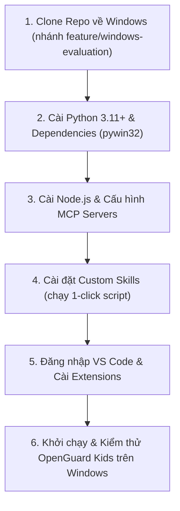

# Hướng Dẫn Di Chuyển & Cài Đặt Toàn Diện Lên Windows (Windows Migration Guide)
## Dự án OpenGuard Kids & Môi trường VS Code / Gemini / MCP / Skills

Tài liệu này tổng hợp toàn bộ hiện trạng cấu hình trên máy Linux Mint hiện tại và cung cấp hướng dẫn từng bước chi tiết để bạn thiết lập, clone mã nguồn và chạy trọn vẹn dự án **OpenGuard Kids** cùng toàn bộ **MCP Servers**, **Skills** và **Tài khoản VS Code** trên máy tính Windows.

---

## PHẦN 1: BÁO CÁO KIỂM TRA MÔI TRƯỜNG HIỆN TẠI (LINUX MINT)

### 1. Trạng thái Đăng Nhập & Tài Khoản (Accounts & Auth)

| Dịch vụ / Công cụ | Tài khoản / Danh tính | Trạng thái / Chi tiết Token |
| :--- | :--- | :--- |
| **Git Config** | `rawcorn-cmd` (`nguyen1002007@gmail.com`) | Đã cấu hình Global |
| **GitHub Remote** | `https://github.com/rawcorn-cmd/OpenGuard-Kids.git` | Kết nối thành công qua HTTPS |
| **GitHub PAT** | `github_pat_11CJTHN2I0...` | Scopes: `repo`, `workflow`, `read:user`, `user:email` |
| **VS Code GitHub** | `rawcorn-cmd` | Đang đăng nhập (Copilot Chat, Sync) |
| **VS Code Microsoft**| Azure Cloud Account (`pca:aebc6443-...`) | Đang lưu trong Secret Storage |
| **Parent Dashboard**| `phuhuynh@giadinh.vn` / `OpenGuard@2026` | Tài khoản phụ huynh quản trị mặc định |
| **Agent Device ID** | `DEV-LOCAL-001` (Gán bé: Bé Bi / Child 1) | Đã map khóa ngoại DB SQLite |

---

### 2. Danh sách MCP Servers Đang Cấu Hình

Trên máy hiện tại, các MCP Server được cấu hình tại 2 vị trí:
1. `~/.config/Code/User/mcp.json` (VS Code Cline/Claude/Copilot)
2. `~/.gemini/config/mcp_config.json` & `~/.gemini/settings.json` (Gemini Antigravity)

| Tên MCP | Nguồn / Package | Lệnh thực thi gốc | Biến môi trường / Tham số |
| :--- | :--- | :--- | :--- |
| **github** | `@modelcontextprotocol/server-github` | `mcp-server-github` | `GITHUB_PERSONAL_ACCESS_TOKEN` |
| **memory** | `@modelcontextprotocol/server-memory` | `mcp-server-memory` | `MEMORY_FILE_PATH=~/.gemini/memory.jsonl` |
| **context7** | `@upstash/context7-mcp` | `context7-mcp` | Không có |
| **playwright** | `@playwright/mcp` | `playwright-mcp` | Không có |
| **sqlite** | `mcp-server-sqlite` | `uvx --with "mcp<2" mcp-server-sqlite` | `--db-path <đường-dẫn-db>` |
| **postgres** | `@modelcontextprotocol/server-postgres` | `mcp-server-postgres` | `postgresql://localhost:5432/postgres` |
| **rea** | `rea-agents` | `rea mcp` | `GHIDRA_INSTALL_DIR`, `REA_JADX_MCP_JAR` |

---

### 3. Danh sách Skills Đang Có

#### A. Custom Skills (Đã được tự động sao lưu vào thư mục `tools/gemini-backup/skills/` trong repo):
1. **`adversarial-testing`**: Kiểm thử biên, click dồn dập, race condition, payload độc hại.
2. **`database-integrity`**: Kiểm tra toàn vẹn SQLite schema, foreign keys, migration, soft-delete.
3. **`frontend-testing`**: Kiểm thử giao diện Svelte 5 runes, stores, DOM interactions.
4. **`qa-orchestrator`**: Điều phối kiểm thử nhiều tầng, quản lý rủi ro và quality gate.
5. **`release-audit`**: Đánh giá release, binary integrity, kiểm tra đóng gói không có lỗi giả.
6. **`reverse-engineer-anything`**: Dịch ngược mã nhị phân, phân tích Electron, web bundle, Android app.
7. **`tauri-desktop-testing`**: Kiểm thử ứng dụng desktop Tauri 2, IPC commands, single-instance.

#### B. Builtin Skills (Tự động đi kèm Antigravity khi cài đặt):
`agy-customizations`, `antigravity_guide`, `automation`, `generative_ui`, `migrate-workflows`, `permissioned-github`, `plugin`, `run-workflow`, `ui-plugin-navigation`.

---

## PHẦN 2: CÁC BƯỚC THIẾT LẬP TRÊN MÁY TÍNH WINDOWS



---

### BƯỚC 1: Clone Repository Về Máy Windows

> [!NOTE]
> Toàn bộ các bản vá đồng bộ hệ thống, sửa lỗi thông báo Tray UI, hỗ trợ xin thêm thời gian, nút Duyệt/Từ chối trên Dashboard và các script Windows 10/11 đã được cam kết và đẩy lên nhánh **`feature/windows-evaluation`**.
> Nhánh `main` vẫn được giữ nguyên an toàn.

Mở **PowerShell** hoặc **Command Prompt** trên Windows:

```cmd
:: 1. Chuyển vào thư mục muốn lưu trữ dự án, ví dụ: C:\Projects
cd C:\Projects

:: 2. Clone trực tiếp nhánh feature/windows-evaluation
git clone -b feature/windows-evaluation https://github.com/rawcorn-cmd/OpenGuard-Kids.git

:: 3. Chuyển vào thư mục dự án
cd OpenGuard-Kids

:: 4. Kiểm tra trạng thái nhánh
git status
```

*(Nếu Git yêu cầu đăng nhập, bạn có thể đăng nhập bằng tài khoản GitHub `rawcorn-cmd` hoặc dán Personal Access Token `github_pat_11CJTHN2I0...` vào ô password).*

---

### BƯỚC 2: Cài Đặt Môi Trường Python 3.11+ & Thư Viện Cần Thiết

1. **Cài đặt Python 3.11 hoặc 3.12**:
   - Tải bộ cài từ trang chính thức: [python.org/downloads](https://www.python.org/downloads/)
   - **Rất quan trọng**: Nhớ tick chọn ô **"Add python.exe to PATH"** trong lúc cài.

2. **Tạo Môi Trường Ảo (Virtual Environment) & Cài Dependencies**:
   Mở PowerShell tại thư mục dự án `C:\Projects\OpenGuard-Kids`:

```cmd
:: Tạo virtual environment
python -m venv .venv

:: Kích hoạt virtual environment
.venv\Scripts\activate

:: Nâng cấp pip
python -m pip install --upgrade pip

:: Cài đặt các gói thư viện dự án (đã bao gồm pywin32 cho Windows Service & Tray UI)
pip install -r requirements.txt

:: Đăng ký DLLs cho pywin32 (cần thiết cho Windows Service)
python .venv\Scripts\pywin32_postinstall.py -install
```

3. **Chạy kiểm thử toàn bộ test suite trên Windows**:
```cmd
pytest tests/ -v
```
*(Bạn sẽ thấy toàn bộ 190/190 bài kiểm thử vượt qua xanh mượt).*

---

### BƯỚC 3: Cài Đặt Node.js & Cấu Hình MCP Servers Trên Windows

1. **Cài đặt Node.js LTS**:
   - Tải bộ cài Node.js v20+ hoặc v22+ LTS từ [nodejs.org](https://nodejs.org/) và cài đặt.

2. **Cài đặt các gói MCP Server toàn cục (Global NPM)**:
   Mở Command Prompt (cmd) với quyền Administrator:
```cmd
npm install -g @modelcontextprotocol/server-github @modelcontextprotocol/server-memory @modelcontextprotocol/server-postgres @playwright/mcp @upstash/context7-mcp
```

3. **Cấu hình MCP cho VS Code & Antigravity trên Windows**:
   - File mẫu cấu hình Windows đã được chuẩn bị sẵn tại: `tools/gemini-backup/mcp_windows_template.json`.
   
   **Cách áp dụng cho Gemini / Antigravity**:
   - Sao chép nội dung từ `tools/gemini-backup/mcp_windows_template.json` vào file:
     `%USERPROFILE%\.gemini\config\mcp_config.json`
     hoặc `%USERPROFILE%\.gemini\settings.json`.
   
   **Cách áp dụng cho VS Code (mcp.json)**:
   - Nhấn `Ctrl + Shift + P` trong VS Code, gõ `Open User Settings (JSON)` hoặc mở trực tiếp:
     `%APPDATA%\Code\User\mcp.json`
   - Đổi key `"mcpServers"` thành `"servers"` và thêm `"type": "stdio"` cho mỗi server như mẫu.

---

### BƯỚC 4: Cài Đặt Custom Skills Vào Máy Windows

Chúng tôi đã sao lưu toàn bộ các Custom Skills vào thư mục `tools/gemini-backup/skills/` trong repo và viết sẵn script tự động:

1. Mở thư mục dự án `C:\Projects\OpenGuard-Kids\tools\gemini-backup\`.
2. Nhấp đúp chuột chạy file: **`install_skills_windows.bat`**.
3. Script sẽ tự động:
   - Tạo thư mục `%USERPROFILE%\.gemini\config\skills\` nếu chưa có.
   - Sao chép đầy đủ 7 custom skills (`adversarial-testing`, `database-integrity`, `frontend-testing`, `qa-orchestrator`, `release-audit`, `reverse-engineer-anything`, `tauri-desktop-testing`) vào đúng vị trí của Antigravity/Gemini.

---

### BƯỚC 5: Đăng Nhập & Cài Đặt Tiện Ích VS Code (Extensions)

1. **Đăng nhập GitHub & Microsoft**:
   - Mở VS Code trên Windows.
   - Ở góc dưới bên trái, nhấp vào biểu tượng **Tài khoản (Accounts icon)** -> Chọn **Sign in with GitHub**.
   - Trình duyệt sẽ mở ra -> Đăng nhập tài khoản `rawcorn-cmd`.
   - Lặp lại để đăng nhập tài khoản Microsoft nếu bạn sử dụng tính năng đồng bộ cài đặt (Settings Sync).

2. **Cài đặt các Extensions khuyến nghị**:
   Mở terminal trong VS Code và chạy lệnh cài nhanh các extension cần thiết:
```cmd
code --install-extension ms-python.python
code --install-extension ms-python.debugpy
code --install-extension ms-python.vscode-pylance
code --install-extension github.copilot
code --install-extension github.copilot-chat
code --install-extension svelte.svelte-vscode
```

---

### BƯỚC 6: Khởi Chạy & Trải Nghiệm OpenGuard Kids Trên Windows

Dự án đã tích hợp sẵn các script chạy 1-click chuyên dụng cho Windows (tự động nhận diện `.venv` và yêu cầu quyền Administrator khi cần thiết):

#### 1. Khởi động Backend Server & Parent Dashboard:
Mở một cửa sổ PowerShell hoặc CMD:
```cmd
.venv\Scripts\activate
uvicorn src.server.app:app --host 127.0.0.1 --port 8000 --reload
```
- Mở trình duyệt truy cập Parent Dashboard: **`http://127.0.0.1:8000/dashboard`**
- Đăng nhập:
  - **Email**: `phuhuynh@giadinh.vn`
  - **Mật khẩu**: `OpenGuard@2026`

#### 2. Cài đặt và Chạy Windows Service (Chế độ chạy ngầm bảo vệ Session 0):
- Chuột phải vào file **`install_service.bat`** -> Chọn **Run as administrator**.
- Dịch vụ `OpenGuardKidsService` sẽ được cài đặt và tự động khởi động cùng Windows.
- *Để kiểm tra*: Mở `services.msc` trong Windows -> tìm dịch vụ `OpenGuard Kids Background Service`.

#### 3. Bật Bảo Vệ Lọc Web & DNS Proxy:
- Chuột phải vào file **`enable_dns_protection.bat`** -> Chọn **Run as administrator**.
- Hệ thống sẽ chuyển hướng DNS về `127.0.0.1:53` để chặn tên miền cấm, web người lớn, mạng xã hội theo quy tắc đã đặt trên Dashboard.
- *(Khi muốn khôi phục lại DNS mạng bình thường, chỉ cần chuột phải vào file `restore_dns.bat` -> chọn Run as administrator)*.

#### 4. Khởi chạy Ứng Dụng Khay Hệ Thống (Tray UI):
- Nhấp đúp chuột vào file **`setup_tray_startup.bat`** để tạo shortcut tự khởi động cùng Windows, hoặc chạy trực tiếp:
```cmd
.venv\Scripts\python -m src.tray.gui
```
- Biểu tượng OpenGuard Kids sẽ xuất hiện trên khay hệ thống (System Tray cạnh đồng hồ Windows).
- Khi bé nhấp chuột phải:
  - Xem thời gian sử dụng hôm nay.
  - Nhấn **"Xin thêm thời gian"**: Giao diện nhập lý do và số phút (15 phút, 30 phút,...) xuất hiện. Khi gửi, thông báo lập tức đẩy lên Dashboard của phụ huynh.
  - Phụ huynh chỉ cần nhấn **"Đồng ý (+15m)"** hoặc **"Từ chối"** trên Dashboard, Tray UI của trẻ sẽ nhận ngay thông báo native của Windows và cập nhật số phút sử dụng ngay lập tức!

---

## TỔNG KẾT DANH MỤC TÀI LIỆU & FILE MIGRATION

Toàn bộ các file phục vụ quá sinh chuyển giao đã được chuẩn bị sẵn trong repo:
- Hướng dẫn tổng thể: [`docs/WINDOWS_SETUP_AND_MIGRATION_GUIDE.md`](file:///home/cornar/Projects/OpenGuard-Kids/docs/WINDOWS_SETUP_AND_MIGRATION_GUIDE.md)
- Custom Skills backup: [`tools/gemini-backup/skills/`](file:///home/cornar/Projects/OpenGuard-Kids/tools/gemini-backup/skills/)
- Script cài đặt Skills tự động trên Windows: [`tools/gemini-backup/install_skills_windows.bat`](file:///home/cornar/Projects/OpenGuard-Kids/tools/gemini-backup/install_skills_windows.bat)
- Cấu hình MCP Windows template: [`tools/gemini-backup/mcp_windows_template.json`](file:///home/cornar/Projects/OpenGuard-Kids/tools/gemini-backup/mcp_windows_template.json)
- Các file thực thi Windows: [`install_service.bat`](file:///home/cornar/Projects/OpenGuard-Kids/install_service.bat), [`enable_dns_protection.bat`](file:///home/cornar/Projects/OpenGuard-Kids/enable_dns_protection.bat), [`setup_tray_startup.bat`](file:///home/cornar/Projects/OpenGuard-Kids/setup_tray_startup.bat), [`restore_dns.bat`](file:///home/cornar/Projects/OpenGuard-Kids/restore_dns.bat), [`uninstall_all.bat`](file:///home/cornar/Projects/OpenGuard-Kids/uninstall_all.bat).
