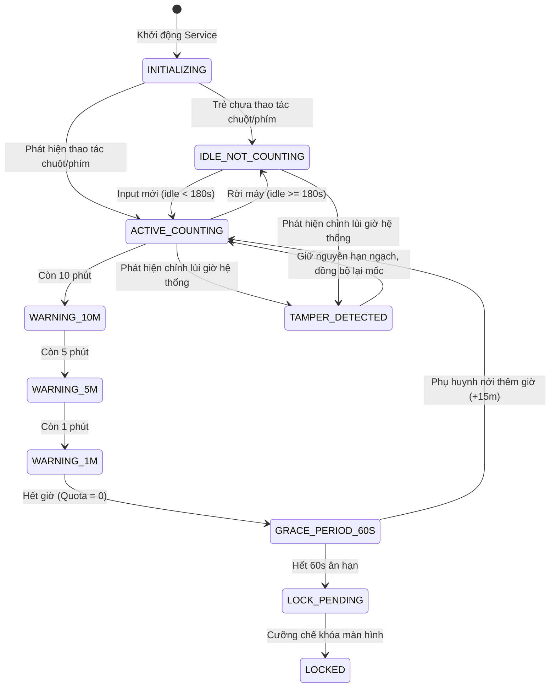

# THÀNH PHẦN 03: BỘ ĐẾM THỜI GIAN MÀN HÌNH (SCREEN-TIME TRACKER) & BẪY LÙI ĐỒNG HỒ

> **Mô-đun:** [`src/agent/screen_time.py`](file:///home/cornar/Projects/OpenGuard-Kids/src/agent/screen_time.py)  
> **API Hệ thống:** `user32.GetLastInputInfo`, `time.monotonic()`, `time.time()`  
> **Đặc tả kiểm thử:** Sai số thực nghiệm $\le \pm 30$s trên mỗi 1 giờ thực tế (Vượt chuẩn đề tài $\pm 60$s/h)

---

## 1. Nền Tảng Công Cụ & Framework Kỹ Thuật

Bộ đếm thời gian màn hình OpenGuard Kids được xây dựng dựa trên sự kết hợp giữa Win32 Subsystem và các hàm thời gian mật mã học của Python:

1. **Hàm Windows API `user32.GetLastInputInfo`:**
   * Cung cấp thông tin về thời điểm có thao tác gần nhất của người dùng trên toàn hệ thống (bấm phím bàn phím, di chuột, cuộn chuột hoặc chạm màn hình cảm ứng).
   * Dữ liệu trả về qua cấu trúc `LASTINPUTINFO`:
     ```c
     typedef struct tagLASTINPUTINFO {
         UINT  cbSize;
         DWORD dwTime; // Thời điểm tính bằng tick count (mili-giây) từ lúc khởi động Windows
     } LASTINPUTINFO;
     ```
   * Hàm này nhẹ, không tạo hook bàn phím (tránh bị phần mềm diệt virus Antivirus cảnh báo nhầm là Keylogger).
2. **Hàm `time.monotonic()` vs `time.time()`:**
   * `time.time()`: Trả về thời gian đồng hồ thực (Wall-clock time) theo chuẩn UNIX epoch. Đồng hồ này có thể bị người dùng thay đổi thủ công qua Date & Time Settings hoặc qua NTP sync.
   * `time.monotonic()`: Đồng hồ đơn điệu tuyệt đối tăng dần theo xung nhịp của CPU (QueryPerformanceCounter trong nhân Windows NT). Đồng hồ này **KHÔNG THỂ BỊ CHỈNH LÙI** bởi bất kỳ hành động nào của người dùng.

---

## 2. Chức Năng Cốt Lõi

* **Đo Đạc Thời Gian Thực Tế (Active Time vs Idle Time):** Phân biệt chính xác giữa thời gian trẻ đang ngồi học/chơi trên máy và thời gian trẻ đã rời máy nhưng vẫn để màn hình sáng.
* **Cưỡng Chế Hạn Ngạch Kép (Daily Quota & Weekly Schedule):**
  * Hạn ngạch tổng thời lượng trong ngày (Ví dụ: tối đa 120 phút/ngày).
  * Khung giờ cho phép sử dụng trong tuần (Ví dụ: Thứ 2 - Thứ 6 chỉ được dùng từ 17:00 đến 20:00; Thứ 7 - Chủ nhật từ 08:00 đến 21:00).
* **Phát Hiện & Khắc Chế Hành Vi Gian Lận Lùi Giờ (Anti-Clock Rollback):** Vô hiệu hóa thủ thuật phổ biến của trẻ em là vào mục Settings chỉnh lùi đồng hồ máy tính về quá khứ để được dùng thêm giờ.

---

## 3. Cơ Chế Vận Hành Chuyên Sâu

### 3.1. Máy Trạng Thái Hữu Hạn 10 Bước (10-State Finite State Machine)



### 3.2. Thuật Toán Lọc Nhàn Rỗi (Idle Threshold)
Mỗi giây (`dt = 1.0s`), hệ thống tính toán thời gian trôi qua kể từ lần thao tác cuối:
$$\text{idle\_seconds} = \frac{\text{GetTickCount}() - \text{dwTime}}{1000}$$
* Nếu $\text{idle\_seconds} < 180$: Trẻ đang hoạt động tích cực &rarr; $\text{consumed\_seconds} += dt$.
* Nếu $\text{idle\_seconds} \ge 180$: Trẻ đã rời máy &rarr; Giữ nguyên $\text{consumed\_seconds}$, không trừ hạn ngạch của trẻ.

### 3.3. Thuật Toán Bẫy Lùi Đồng Hồ Hệ Thống (Clock Rollback Trap)
```python
import time

class ScreenTimeTracker:
    def __init__(self, daily_quota_seconds: int = 7200):
        self.daily_quota = daily_quota_seconds
        self.consumed_seconds = 0
        self.last_wall_clock = time.time()
        self.last_mono_clock = time.monotonic()
        self.tamper_detected = False

    def update_tick(self, is_active: bool):
        current_wall = time.time()
        current_mono = time.monotonic()

        delta_wall = current_wall - self.last_wall_clock
        delta_mono = current_mono - self.last_mono_clock

        # BẪY PHÁT HIỆN: Nếu giờ hệ thống bị lùi lại quá 60 giây
        if delta_wall < -60.0:
            self.tamper_detected = True
            # QUY TẮC CỐT LÕI: Thời gian đã dùng KHÔNG BAO GIỜ bị trừ lùi!
            # Ghi nhận nhật ký gian lận để báo cáo phụ huynh
            # Cập nhật lại mốc wall_clock theo mốc hiện tại
            self.last_wall_clock = current_wall
            self.last_mono_clock = current_mono
            return

        # Nếu đang hoạt động bình thường:
        if is_active:
            # Sử dụng delta_mono để cộng dồn chính xác theo xung nhịp CPU
            self.consumed_seconds += delta_mono

        self.last_wall_clock = current_wall
        self.last_mono_clock = current_mono
```

---

## 4. Cách Liên Kết Với Các Thành Phần Khác

1. **Với Tray UI (Thành phần 8):** Gửi các sự kiện chuyển trạng thái `WARNING_10M`, `WARNING_5M`, `WARNING_1M` và `GRACE_PERIOD_60S` qua Loopback IPC để kích hoạt thông báo Toast và hộp thoại ân hạn.
2. **Với Offline Buffer (Thành phần 7):** Khi trạng thái chuyển sang `LOCKED` hoặc phát hiện `TAMPER_DETECTED`, tạo gói sự kiện ghi đệm vào SQLite để sẵn sàng đồng bộ lên Server.
3. **Với WebSocket Hub (Thành phần 11):** Khi phụ huynh gửi lệnh `ADD_TIME` qua WebSocket, `ScreenTimeTracker` lập tức tăng `daily_quota += extra_seconds` và chuyển trạng thái từ `LOCKED` hoặc `GRACE_PERIOD_60S` trở lại `ACTIVE_COUNTING`.

