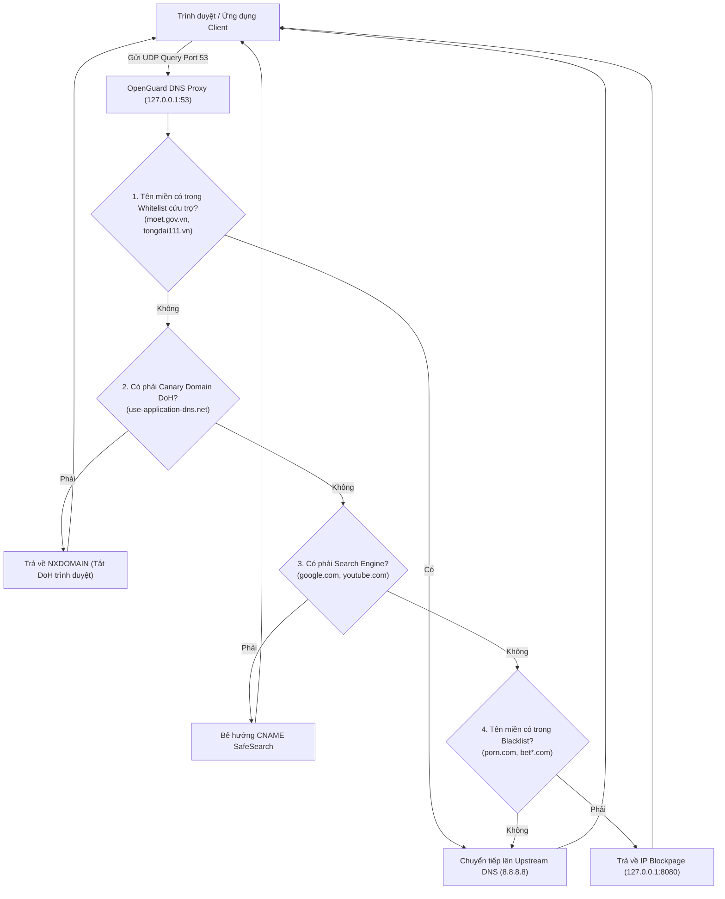

# THÀNH PHẦN 05: MÁY CHỦ PHÂN GIẢI DNS PROXY (PORT 53) & KHẮC CHẾ DoH

> **Mô-đun:** [`src/agent/dns_proxy.py`](file:///home/cornar/Projects/OpenGuard-Kids/src/agent/dns_proxy.py)  
> **Thư viện:** `dnslib`, `asyncio` UDP Sockets &bull; **Cổng:** `127.0.0.1:53`  
> **Tiêu chuẩn mạng:** RFC 1035 (DNS), RFC 8484 (DNS over HTTPS - DoH)

---

## 1. Nền Tảng Công Cụ & Framework Kỹ Thuật

DNS Proxy là tuyến phòng thủ vòng ngoài trong mô hình kiểm soát nội dung web của OpenGuard Kids:

1. **Thư viện `dnslib` (Python DNS Library):**
   * Cho phép bóc tách (parse) và đóng gói (serialize) nhị phân các gói tin DNS Message (Header, Question, Answer, Authority, Additional Records) với hiệu năng cao.
   * Hỗ trợ đầy đủ các bản ghi chuẩn: `A` (IPv4), `AAAA` (IPv6), `CNAME` (Tên miền bí danh), `TXT`, và `SOA`.
2. **Giao thức UDP Không đồng bộ `asyncio.DatagramProtocol`:**
   * Lắng nghe lưu lượng DNS trên cổng chuẩn UDP 53 của giao diện Loopback `127.0.0.1`.
   * Mô hình Event-loop non-blocking cho phép xử lý hàng nghìn truy vấn tên miền mỗi giây với độ trễ xử lý nội bộ $< 2.0$ ms.
3. **Cơ Chế Bẻ Hướng CNAME (Canonical Name Rewriting):**
   * Khi ứng dụng hỏi địa chỉ IP của một tên miền công cụ tìm kiếm, DNS Proxy không gửi truy vấn gốc lên DNS nhà mạng, mà chèn một bản ghi `CNAME` ép buộc trình duyệt phân giải về cụm máy chủ SafeSearch được nhà cung cấp (Google, Microsoft) thiết lập riêng.

---

## 2. Chức Năng Cốt Lõi

* **Lọc Tên Miền Độc Hại & Trực Tuyến Đen:** Chặn các website nội dung người lớn, cờ bạc, bạo lực bằng kỹ thuật DNS Sinkholing (chuyển hướng tên miền xấu về trang Blockpage nội bộ `127.0.0.1:8080`).
* **Cưỡng Chế Tìm Kiếm An Toàn (SafeSearch Enforcement):** Tự động lọc sạch kết quả tìm kiếm hình ảnh và video độc hại trên Google Search, YouTube, và Bing.
* **Ba Lớp Khắc Chế Thủ Thuật DoH (DNS-over-HTTPS Anti-Bypass):** Vô hiệu hóa việc trình duyệt cố tình bypass DNS bằng cách mã hóa gói tin DNS qua cổng HTTPS 443.
* **Whitelist Bất Biến (Permanent Whitelist):** Bảo đảm không bao giờ chặn nhầm các dịch vụ công, trường học và cứu trợ quốc gia.

---

## 3. Cơ Chế Vận Hành Chuyên Sâu

### 3.1. Sơ Đồ Xử Lý Gói Tin DNS Tại Proxy



### 3.2. Chi Tiết Bản Ghi Bẻ Hướng SafeSearch
Khi nhận truy vấn `A Record` từ Client:
* **Google:** `google.com`, `www.google.com` &rarr; Trả về CNAME `forcesafesearch.google.com` (IP: `216.239.38.120`).
* **YouTube:** `youtube.com`, `www.youtube.com` &rarr; Trả về CNAME `restrict.youtube.com` (IP: `216.239.38.119` - Chế độ Strict Mode).
* **Bing:** `bing.com`, `www.bing.com` &rarr; Trả về CNAME `strict.bing.com` (IP: `204.79.197.220`).

### 3.3. Ba Tầng Khắc Chế DNS-over-HTTPS (DoH Mitigation Strategy)
1. **Tầng 1 (Canary Domain Spoofing):**
   * Firefox và Chrome kiểm tra tên miền Canary `use-application-dns.net` trước khi tự động kích hoạt DoH.
   * DNS Proxy phản hồi mã `RCODE = 3 (NXDOMAIN)`. Nhận tín hiệu này, trình duyệt hiểu rằng mạng nội bộ đang áp dụng chính sách quản lý và tự động quay về DNS cổng 53 của hệ thống.
2. **Tầng 2 (Chặn Port 443 tới DoH Resolvers):**
   * Chặn truy cập tới dải IP máy chủ DoH công cộng (`cloudflare-dns.com`, `dns.google`, `1.1.1.1`, `8.8.8.8`, `9.9.9.9`).
3. **Tầng 3 (Chặn Dự Phòng qua File Cục Bộ Hosts):**
   * Định tuyến các domain DoH về `0.0.0.0` trong file `hosts` của Windows.

### 3.4. Kịch Bản Khôi Phục Mạng Khẩn Cấp (Emergency Restore Script)
Cung cấp file [`scripts/emergency_restore_dns.bat`](file:///home/cornar/Projects/OpenGuard-Kids/scripts/emergency_restore_dns.bat) cho phụ huynh:
```cmd
@echo off
echo [*] Dang khoi phuc DNS he thong ve mac dinh...
netsh interface ip set dns name="Wi-Fi" source=dhcp
netsh interface ip set dns name="Ethernet" source=dhcp
ipconfig /flushdns
echo [SUCCESS] Da khoi phuc mang ve trang thai ban dau!
```

---

## 4. Cách Liên Kết Với Các Thành Phần Khác

1. **Với Polite Blockpage Server (Thành phần 6):** Khi một tên miền bị chặn, DNS Proxy trả về địa chỉ IP `127.0.0.1` để trình duyệt kết nối trực tiếp vào Blockpage Server cổng 8080.
2. **Với Offline Buffer (Thành phần 7):** Khi có hành vi truy cập tên miền cấm, gửi sự kiện `DOMAIN_BLOCKED` vào bộ đệm SQLite để đồng bộ lên máy chủ báo cáo.

