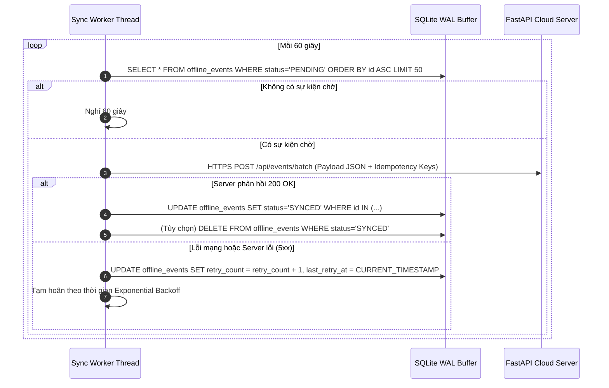

# THÀNH PHẦN 07: BỘ ĐỆM SỰ KIỆN NGOẠI TUYẾN SQLITE WAL & RETRY BACKOFF

> **Mô-đun:** [`src/agent/offline_buffer.py`](file:///home/cornar/Projects/OpenGuard-Kids/src/agent/offline_buffer.py)  
> **Công nghệ:** SQLite 3 với chế độ ghi nhật ký trước **WAL (Write-Ahead Logging)**  
> **Cơ chế chống trùng lặp:** Khóa `Idempotency-Key` (UUIDv4) & Thuật toán Thử lại Lũy thừa có Rung lắc (Exponential Backoff with Jitter)

---

## 1. Nền Tảng Công Cụ & Framework Kỹ Thuật

Bộ đệm ngoại tuyến bảo đảm khả năng chịu lỗi (Fault Tolerance) của OpenGuard Kids trong các điều kiện mạng thực tế khắc nghiệt:

1. **Động cơ Cơ sở dữ liệu SQLite ở chế độ WAL Mode:**
   * SQLite là cơ sở dữ liệu nhúng (In-process DBMS) không yêu cầu cài đặt máy chủ riêng biệt, hoàn hảo cho ứng dụng Client máy tính.
   * Kích hoạt chế độ `PRAGMA journal_mode=WAL;`:
     * Cho phép luồng đọc (Readers) và luồng ghi (Writers) hoạt động đồng thời mà không bị khóa lẫn nhau (Non-blocking Concurrency).
     * Ghi nhanh trực tiếp vào file log `.wal` trước khi nén vào file chính `.db`, bảo toàn dữ liệu 100% ngay cả khi máy tính bị sập nguồn đột ngột.
2. **Chuẩn Định Danh Duy Nhất Toàn Cầu UUIDv4 (RFC 4122):**
   * Mỗi sự kiện sinh ra trên máy con được cấp một mã `idempotency_key` 128-bit ngẫu nhiên.
   * Loại bỏ hoàn toàn nguy cơ trùng lặp bản ghi khi đường truyền mạng bị ngắt quãng giữa chừng.
3. **Mô Hình Đồng Bộ Đợt (Batch Synchronization):**
   * Gom các sự kiện lẻ tẻ thành một danh sách gửi một lần qua HTTPS POST, tiết kiệm băng thông và giảm tải xử lý cho máy chủ Cloud.

---

## 2. Chức Năng Cốt Lõi

* **Lưu Trữ An Toàn Khi Mất Mạng:** Đảm bảo không làm thất thoát nhật ký sử dụng, sự kiện chặn lọc và cảnh báo vi phạm khi máy tính bị mất WiFi, rút cáp mạng hoặc Server bảo trì.
* **Gửi Lại Thông Minh (Smart Retry Mechanism):** Tự động thăm dò kết nối và thử gửi lại các sự kiện đang chờ (`PENDING`) theo thuật toán hồi phục mạng.
* **Bảo Vệ Tính Toàn Vẹn & Khử Trùng Lặp (Idempotent Delivery):** Đảm bảo mỗi sự kiện chỉ được máy chủ ghi nhận đúng 1 lần duy nhất, kể cả khi quá trình gửi bị retry nhiều lần.

---

## 3. Cơ Chế Vận Hành Chuyên Sâu

### 3.1. Lược Đồ Bảng Đệm SQLite Cục Bộ (`offline_events`)
```sql
CREATE TABLE IF NOT EXISTS offline_events (
    id INTEGER PRIMARY KEY AUTOINCREMENT,
    idempotency_key TEXT UNIQUE NOT NULL,
    event_type TEXT NOT NULL,           -- PROCESS_LAUNCH, DOMAIN_BLOCKED, QUOTA_EXCEEDED
    payload TEXT NOT NULL,              -- JSON string chỉ chứa 7 trường siêu dữ liệu tối thiểu
    status TEXT DEFAULT 'PENDING',      -- PENDING, SYNCED, FAILED
    retry_count INTEGER DEFAULT 0,
    created_at TIMESTAMP DEFAULT CURRENT_TIMESTAMP,
    last_retry_at TIMESTAMP
);

CREATE INDEX IF NOT EXISTS idx_status_created ON offline_events(status, created_at);
```

### 3.2. Thuật Toán Gửi Lại Lũy Thừa Có Rung Lắc (Exponential Backoff with Jitter)
Khi kết nối mạng gặp sự cố (Timeout, HTTP 500, Connection Refused), thời gian tạm hoãn thử lại tiếp theo được tính toán:

$$\text{Delay} = \min\left(300,\; 1.5 \times 2^{\text{retry\_count}}\right) + \text{Uniform}(0, 2.0)$$

* **Tại sao cần Jitter (Rung lắc ngẫu nhiên)?**  
  Nếu trong mạng gia đình hoặc trường học có 50 máy tính cùng mất mạng lúc 10:00 và có mạng lại lúc 10:30, việc thêm một khoảng thời gian ngẫu nhiên $0 \sim 2$ giây giúp các máy tính không đồng loạt tấn công dồn dập vào Server cùng một tích tắc (Khắc phục triệt để hội chứng **Thundering Herd Problem**).

### 3.3. Quy Trình Đồng Bộ Hóa Dữ Liệu


---

## 4. Cách Liên Kết Với Các Thành Phần Khác

1. **Với ScreenTime Tracker & Process Monitor (Thành phần 3, 4):** Là điểm tiếp nhận cuối cùng của mọi thông tin nhật ký sinh ra từ các bộ phận giám sát ở Session 0.
2. **Với FastAPI Server (Thành phần 9):** Đóng vai trò Client gửi dữ liệu qua kênh HTTPS REST API chuẩn hóa.
3. **Với Cơ chế Xóa Kép (Thành phần 13):** Khi phụ huynh gửi lệnh xóa dữ liệu qua WebSocket, toàn bộ các dòng trong bảng `offline_events` sẽ được xóa sạch ngay lập tức (`DELETE FROM offline_events; VACUUM;`).

