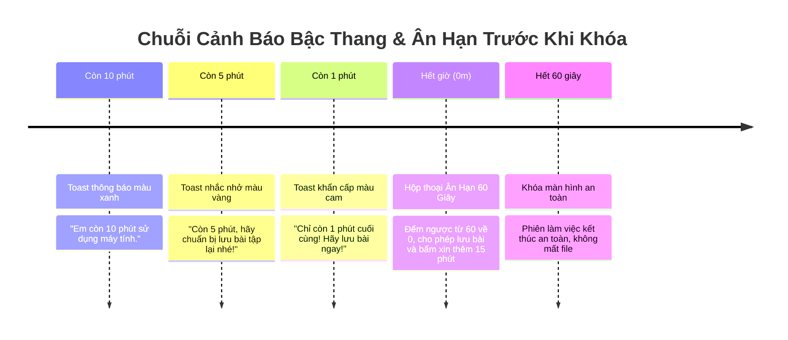

# THÀNH PHẦN 08: ỨNG DỤNG KHAY HỆ THỐNG MINH BẠCH TRAY UI & ÂN HẠN 60S

> **Mô-đun:** [`src/agent/tray_app.py`](file:///home/cornar/Projects/OpenGuard-Kids/src/agent/tray_app.py)  
> **Thư viện:** `pystray` / `PyQt5`, `win10toast` / Win32 Shell API  
> **Môi trường chạy:** Windows Session 1 (Phiên đồ họa của người dùng)  
> **Nguyên tắc nhân văn:** NT1 (Trẻ biết mình được hỗ trợ), NT5 (Minh bạch hai chiều)

---

## 1. Nền Tảng Công Cụ & Framework Kỹ Thuật

Tray UI là giao diện đại diện trực tiếp cho OpenGuard Kids trước mắt trẻ em:

1. **Khu Vực Khay Thông Báo Windows (Notification Area / System Tray):**
   * Được quản lý bởi tiến trình Windows Shell (`explorer.exe`) thông qua hàm API `Shell_NotifyIcon`.
   * Sử dụng thư viện Python `pystray` kết hợp với thư viện xử lý ảnh `Pillow (PIL)` để tạo và vẽ động hình ảnh icon hiển thị số phút còn lại (Ví dụ: icon tròn màu xanh có chữ `45m`).
2. **Hệ Thống Thông Báo Bậc Thang Windows Toast Notification:**
   * Sử dụng Windows Action Center API để đẩy các thông báo nổi góc dưới bên phải màn hình.
   * Thông báo tương tác có thể đính kèm nút bấm (Action Buttons).
3. **Cửa Sổ Hộp Thoại Ân Hạn (Grace Period Dialog Window):**
   * Được thiết kế với thuộc tính cửa sổ `HWND_TOPMOST` (luôn nổi lên trên cùng) nhưng **KHÔNG CƯỚNG CHẾ CHIẾM TIÊU ĐIỂM BÀN PHÍM (Non-Modal Focus)** để trẻ vẫn có thể click chuột vào phần mềm Word/PowerPoint đang mở để bấm tổ hợp phím `Ctrl + S` lưu bài.

---

## 2. Chức Năng Cốt Lõi

* **Tuyệt Đối Không Chạy Ngầm (Anti-Spyware Principle):** Biểu tượng OpenGuard Kids luôn hiện diện công khai trên Taskbar. Trẻ luôn biết rõ mình đang được phần mềm đồng hành hỗ trợ quản lý thời gian.
* **Chuỗi Thông Báo Bậc Thang Nhắc Nhở Trước:** Gửi thông báo Toast nhắc nhở trước 10 phút, 5 phút, và 1 phút để trẻ chủ động chuẩn bị kết thúc buổi học/chơi.
* **Cơ Chế 60 Giây Ân Hạn Lưu Bài (Save Work Grace Period):** Tuyệt đối không bao giờ dập tắt máy hay khóa màn hình đột ngột khi hết giờ; luôn cấp 60 giây đếm lùi để trẻ lưu giữ thành quả bài tập.
* **Màn Hình Minh Bạch 1:1 ("Hôm Nay Em Đã Dùng Gì"):** Cho phép trẻ tự xem thống kê thời gian và ứng dụng của chính mình, đảm bảo tính công bằng: dữ liệu trẻ nhìn thấy giống hệt những gì cha mẹ thấy trên Dashboard.

---

## 3. Cơ Chế Vận Hành Chuyên Sâu

### 3.1. Chuỗi Thông Báo Bậc Thang (Escalating Toast Warnings)



### 3.2. Thuật Toán Sinh Biểu Tượng Icon Đếm Ngược Động
```python
from PIL import Image, ImageDraw, ImageFont
import pystray

def create_dynamic_tray_icon(remaining_minutes: int, is_alert: bool = False) -> Image.Image:
    # Tạo ảnh vuông 64x64 pixel
    image = Image.new("RGBA", (64, 64), color=(0, 0, 0, 0))
    draw = ImageDraw.Draw(image)

    # Chọn màu sắc theo trạng thái:
    # Bình thường: Xanh dương (#0284c7)
    # Báo động đỏ (mất service): Đỏ (#dc2626)
    bg_color = (220, 38, 38) if is_alert else (2, 132, 199)
    draw.ellipse((2, 2, 62, 62), fill=bg_color)

    # Vẽ số phút còn lại vào giữa icon:
    text = f"{remaining_minutes}m" if remaining_minutes < 100 else "99+"
    # Canh giữa text
    draw.text((32, 32), text, fill=(255, 255, 255), anchor="mm")
    return image
```

### 3.3. Menu Chuột Phải Trao Quyền Cho Trẻ (Child Agency Context Menu)
Khi trẻ bấm chuột phải vào biểu tượng khay, menu hiện ra các lựa chọn:
1. `Xem thời gian còn lại`: Hiển thị bảng tổng hợp ngày hôm nay.
2. `Xin cha mẹ thêm 15 phút`: Mở hộp thoại nhập lý do ngắn (Ví dụ: *"Em đang làm nốt bài tập tiếng Anh"*) và gửi thẳng về máy chủ.
3. `Hôm nay em đã dùng gì`: Mở cửa sổ đối chiếu 1:1 minh bạch.
4. `Giới thiệu OpenGuard Kids`: Thông tin phiên bản và số điện thoại hỗ trợ trẻ em 111.
*(Menu cố tình **KHÔNG CÓ** nút "Thoát ứng dụng" để đảm bảo tính kỷ luật giám sát)*.

---

## 4. Cách Liên Kết Với Các Thành Phần Khác

1. **Với Loopback IPC (Thành phần 2):** Liên tục lấy dữ liệu từ `127.0.0.1:8765/status` để vẽ lại icon và hiển thị menu; gửi các thao tác bấm nút của trẻ ngược trở lại Service.
2. **Với ScreenTime Tracker (Thành phần 3):** Phản ánh trạng thái máy trạng thái FSM (đang hoạt động, đang nhàn rỗi, hay chuẩn bị khóa) lên giao diện người dùng trực quan.

