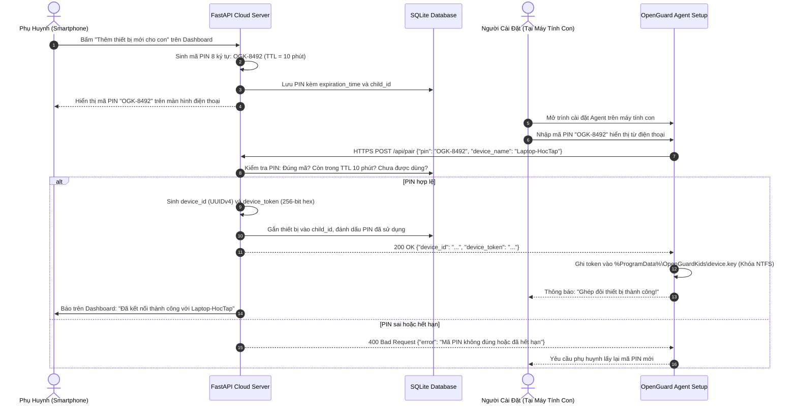

# THÀNH PHẦN 10: QUY TRÌNH GHÉP ĐÔI THIẾT BỊ BẰNG MÃ PIN 8 KÝ TỰ

> **Mô-đun:** [`src/server/app.py`](file:///home/cornar/Projects/OpenGuard-Kids/src/server/app.py) & Client Setup Wizard  
> **Cơ chế:** Mã PIN ngẫu nhiên 8 ký tự, TTL 10 phút, cấp phát Device Token 256-bit  
> **Căn cứ pháp lý:** Điều 4 Nghị định 13/2023/NĐ-CP (Xác nhận sự đồng ý rõ ràng của cha mẹ)

---

## 1. Nền Tảng Công Cụ & Framework Kỹ Thuật

Giao thức ghép đôi thiết bị (Device Pairing Protocol) thiết lập quan hệ tin cậy mật mã học giữa phần mềm cài trên máy tính con và tài khoản của phụ huynh trên Cloud Server:

1. **Mô-đun Sinh Số Ngẫu Nhiên Mật Mã Học `secrets` (PEP 506):**
   * Sử dụng nguồn entropy cấp hệ điều hành (`/dev/urandom` hoặc `CryptGenRandom` trên Windows) để sinh mã PIN không thể đoán trước.
   * Tập ký tự loại trừ các ký tự dễ nhầm lẫn (như số `0` và chữ `O`, số `1` và chữ `I`, `l`) nhằm tối ưu trải nghiệm nhập liệu cho cha mẹ.
2. **Cơ Chế Thời Hạn Sống Tự Hủy (Time-To-Live - TTL):**
   * Mã PIN chỉ có hiệu lực tối đa 600 giây (10 phút).
   * Hạn chế tối đa nguy cơ mã bị lộ hoặc bị quét vét cạn (Brute-force PIN Attack).
3. **Mã Token Thiết Bị 256-bit (Device Authentication Token):**
   * Được sinh bằng `secrets.token_hex(32)`.
   * Gắn chặt với `device_id` (UUIDv4) của máy con và lưu trữ bảo mật trên ổ đĩa.

---

## 2. Chức Năng Cốt Lõi

* **Liên Kết Máy Tính Của Trẻ Vào Gia Đình:** Cho phép phụ huynh dễ dàng thêm một máy tính mới của con vào bảng điều khiển chỉ trong 30 giây.
* **Xác Lập Quyền Hợp Pháp Của Cha Mẹ:** Thể hiện bằng chứng pháp lý rằng việc cài đặt phần mềm quản lý trên máy tính đã được sự đồng thuận và chủ động thực hiện trực tiếp bởi chính phụ huynh.
* **Cấp Phát Chứng Thư Truy Cập Dài Hạn:** Sau khi ghép đôi thành công, máy con không cần phụ huynh phải nhập lại mật khẩu trong suốt quá trình hoạt động.

---

## 3. Cơ Chế Vận Hành Chuyên Sâu

### 3.1. Sơ Đồ Trình Tự Bắt Tay Ghép Đôi Thiết Bị



### 3.2. Thuật Toán Sinh & Kiểm Tra Mã PIN
```python
import secrets
import time
from typing import Dict, Any

class PairingService:
    ALPHABET = "23456789ABCDEFGHJKLMNPQRSTUVWXYZ"  # Loại bỏ 0, O, 1, I để tránh nhầm lẫn

    def generate_pin(self, child_id: int) -> str:
        # Sinh chuỗi định dạng OGK-XXXX
        random_suffix = "".join(secrets.choice(self.ALPHABET) for _ in range(4))
        pin = f"OGK-{random_suffix}"
        
        # Lưu vào bộ đệm kèm thời gian hết hạn (10 phút):
        self.store_pin_record(pin, {
            "child_id": child_id,
            "expires_at": time.time() + 600,
            "used": False
        })
        return pin

    def verify_and_claim_pin(self, pin: str, device_name: str) -> Dict[str, Any]:
        record = self.get_pin_record(pin.strip().upper())
        if not record:
            raise ValueError("Mã PIN không tồn tại")
        if record["used"]:
            raise ValueError("Mã PIN này đã được sử dụng")
        if time.time() > record["expires_at"]:
            raise ValueError("Mã PIN đã hết thời hạn 10 phút")

        # Đánh dấu đã dùng:
        record["used"] = True
        
        # Cấp phát định danh thiết bị:
        device_id = str(uuid.uuid4())
        device_token = secrets.token_hex(32)
        self.save_new_device(device_id, device_token, record["child_id"], device_name)
        
        return {"device_id": device_id, "device_token": device_token}
```

---

## 4. Cách Liên Kết Với Các Thành Phần Khác

1. **Với Parent Web Dashboard (Thành phần 12):** Nơi khởi phát yêu cầu ghép đôi và hiển thị mã PIN cho cha mẹ.
2. **Với Windows Service (Thành phần 1):** Tiếp nhận `device_token` để sử dụng làm Bearer Token cho toàn bộ các giao tiếp mạng HTTPS và WebSocket tiếp theo.
3. **Với SQLite Offline Buffer (Thành phần 7):** Đính kèm `device_id` vào header của các đợt gửi dữ liệu sự kiện.

