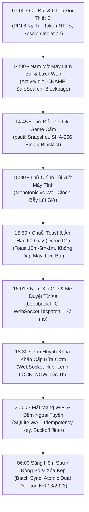

# THÀNH PHẦN 16: KỊCH BẢN TỔNG QUÁT E2E & HOẠT ĐỘNG PHỐI HỢP CỦA HỆ THỐNG

> **Tiêu đề:** Kịch bản Vận hành Toàn diện Một Ngày Điển Hình của Gia Đình cùng OpenGuard Kids  
> **Mục tiêu:** Phân tích trực quan và sâu sắc cách thức **toàn bộ 15 thành phần kỹ thuật** phối hợp nhịp nhàng bên dưới tầng hệ điều hành Windows và mạng máy tính trong suốt một chu trình sử dụng thực tế.

---

## 1. BỐI CẢNH & NHÂN VẬT GIẢ ĐỊNH

* **Phụ huynh:** Anh Hoàng (Sử dụng điện thoại thông minh iPhone truy cập Web Dashboard).
* **Trẻ em:** Bé Nam (10 tuổi, học sinh lớp 5, sử dụng Laptop chạy Windows 11 x64 để học tập và giải trí).
* **Chính sách gia đình:** Hạn ngạch ngày: **120 phút/ngày**; Cấm truy cập web cờ bạc/người lớn; Cấm chơi game bạo lực; Bắt buộc bật SafeSearch trên Google & YouTube.

---

## 2. SƠ ĐỒ DÒNG THỜI GIAN TOÀN DIỆN (CHRONOLOGICAL TIMELINE)



---

## 3. CHI TIẾT TỪNG GIAI ĐOẠN & HOẠT ĐỘNG KỸ THUẬT BÊN DƯỚI HỆ THỐNG

### Giai đoạn 1: 07:00 — Khởi Tạo Ban Đầu & Ghép Đôi Thiết Bị (Pairing Protocol)
* **Hành vi người dùng:** Anh Hoàng mở trình duyệt trên điện thoại vào trang quản trị OpenGuard Kids, đăng ký tài khoản và bấm *"Thêm thiết bị mới cho con"*. Sau đó, anh mở laptop của Nam để cài đặt phần mềm.
* **Hoạt động bên dưới hệ thống:**
  1. **Thành phần 9 (FastAPI Server):** Tiếp nhận thông tin đăng ký của phụ huynh, thực hiện băm mật khẩu bằng thuật toán **Argon2id (RFC 9106)** với cấu hình an toàn `memory_cost=65536KB, time_cost=2`. Thiết lập Session Cookie bảo mật mang cờ `HttpOnly`, `SameSite=Lax`, `Secure`.
  2. **Thành phần 10 (Ghép Đôi Thiết Bị):** Server sinh mã PIN ngẫu nhiên 8 ký tự `OGK-8492` bằng thư viện `secrets` và đặt thời gian sống `TTL = 600s` (10 phút).
  3. **Thành phần 1 (Windows Service):** Trên laptop của Nam, bộ cài đặt OpenGuard Kids đăng ký dịch vụ `OpenGuardKidsService` với Windows Service Control Manager (SCM) chạy dưới đặc quyền `NT AUTHORITY\LocalSystem` tại **Session 0**. Cấu hình chính sách tự phục hồi khi crash sau 60 giây.
  4. **Thành phần 2 (Loopback IPC):** Windows Service sinh mã bí mật `ipc_token` (64 ký tự hex) và ghi vào file cấu hình bảo vệ bằng phân quyền **NTFS ACL**: chỉ cho phép `SYSTEM` và tài khoản người dùng của Nam được đọc. Mở máy chủ HTTP nội bộ lắng nghe tại `127.0.0.1:8765`.
  5. **Bắt tay hoàn tất:** Anh Hoàng nhập mã `OGK-8492` trên laptop. Service gửi yêu cầu lên Server qua HTTPS. Server xác thực mã PIN hợp lệ, cấp phát cặp khóa `device_id` (UUIDv4) và `device_token` (256-bit). Khởi chạy **Tray UI (Thành phần 8)** vào **Session 1** của Nam.

---

### Giai đoạn 2: 14:00 — Bé Nam Mở Máy Học Tập & Lướt Web (Safe Search & Lọc Web)
* **Hành vi người dùng:** Buổi chiều, Nam bật laptop đăng nhập vào tài khoản Windows của mình để làm bài tập Tiếng Anh và tìm kiếm tư liệu khoa học.
* **Hoạt động bên dưới hệ thống:**
  1. **Thành phần 8 (Tray UI):** Khởi động cùng Windows Shell (`explorer.exe`). Đọc file token NTFS, gửi yêu cầu `GET /status` qua kênh Loopback IPC tới Service. Biểu tượng OpenGuard Kids xuất hiện nổi bật trên Taskbar với số phút đếm lùi `[120m]` màu xanh.
  2. **Thành phần 3 (ScreenTime Tracker):** Gọi hàm Windows API `user32.GetLastInputInfo` mỗi giây. Khi Nam bắt đầu gõ phím và di chuột, hệ thống chuyển máy trạng thái FSM từ `INITIALIZING` sang `ACTIVE_COUNTING`, bắt đầu tính thời gian sử dụng thực tế.
  3. **Thành phần 5 (DNS Proxy):**
     * Nam mở trình duyệt Google Chrome tìm kiếm *"hệ mặt trời"*. Trình duyệt gửi gói tin truy vấn DNS UDP cổng 53 đến `127.0.0.1:53`.
     * DNS Proxy bóc tách gói tin bằng thư viện `dnslib`, phát hiện truy vấn tên miền `google.com`. Thay vì gửi thẳng lên mạng, Proxy bẻ hướng bản ghi CNAME về `forcesafesearch.google.com` (IP: `216.239.38.120`). Toàn bộ hình ảnh tìm kiếm trả về đều được Google kiểm duyệt an toàn tuyệt đối.
     * Trình duyệt Chrome ngầm thăm dò tên miền DoH Canary `use-application-dns.net`. DNS Proxy lập tức trả về mã lỗi `NXDOMAIN` &rarr; Chrome tự động tắt tính năng DNS-over-HTTPS và tuân thủ phân giải qua hệ thống.
  4. **Thành phần 6 (Polite Blockpage):**
     * Nam tò mò gõ thử một trang web game đổi thưởng `bet88.com`. DNS Proxy đối chiếu với danh mục lọc Wildcard `*.bet*`, xác định đây là web cấm và trả về địa chỉ IP cục bộ `127.0.0.1`.
     * Trình duyệt kết nối tới `127.0.0.1:8080`. Máy chủ Blockpage render giao diện giáo dục thân thiện màu vàng ấm: thông báo rõ lý do trang bị chặn, không ngắt mạng giả tạo, cung cấp nút *"Báo Chặn Nhầm"* và hiển thị số điện thoại **Tổng đài Quốc gia Bảo vệ Trẻ em 111**.

---

### Giai đoạn 3: 14:45 — Thử Thủ Thuật Đổi Tên File Game Cấm (Binary Anti-Bypass)
* **Hành vi người dùng:** Nam muốn chơi một tựa game bạo lực bị cha mẹ cấm (`game_banned.exe`). Nam nhớ mẹ dặn không được chơi game, nên Nam đổi tên file thành `winword.exe` (giả làm Microsoft Word) và bấm chạy.
* **Hoạt động bên dưới hệ thống:**
  1. **Thành phần 4 (Process Monitor):**
     * Luồng quét ngầm thực hiện snapshot cây tiến trình qua thư viện `psutil` mỗi 5.0 giây.
     * Phát hiện một tiến trình mới mang tên `winword.exe` nhưng đường dẫn thực thi nằm ở thư mục `C:\Users\Nam\Downloads\`.
     * Process Monitor không tin vào tên file! Nó mở file thực thi ở chế độ nhị phân `rb`, đọc từng khối byte 64KB và tính toán mã băm mật mã học **SHA-256**.
     * Đối chiếu mã băm tính được với Blacklist:
       $$\text{SHA256}(\text{file}) = \text{"e3b0c44298fc1c149afbf4c8996fb92427ae41e4649b934ca495991b7852b855"}$$
     * Mã băm này trùng khớp 100% với mã của game cấm!
  2. **Quy trình kết thúc an toàn hai pha (Two-Phase Termination):**
     * *Pha 1:* Gửi tín hiệu `WM_CLOSE` / `SIGTERM` yêu cầu tiến trình đóng êm dịu.
     * *Pha 2:* Sau 3 giây, gọi hàm Win32 `TerminateProcess` (`SIGKILL`) để tắt triệt để tiến trình.
  3. **Thông báo minh bạch:** Service gửi thông báo qua IPC sang Tray UI để hiển thị Toast thông báo: *"Ứng dụng [winword.exe] bị dừng vì có chữ ký nhị phân trùng với danh mục trò chơi không phù hợp."*
  4. **Thành phần 7 (Offline Buffer):** Ghi sự kiện vi phạm này vào bảng `offline_events` trong SQLite để chuẩn bị đồng bộ cho cha mẹ xem.

---

### Giai đoạn 4: 15:30 — Thử Thủ Thuật Chỉnh Lùi Giờ Máy Tính (Clock Tampering Trap)
* **Hành vi người dùng:** Thấy thời gian đếm lùi trên Taskbar chỉ còn lại 30 phút, Nam mở Windows Settings và chỉnh lùi giờ hệ thống từ 15:30 về 14:00 (lùi lại 90 phút) với hy vọng đồng hồ đếm ngược sẽ tăng thêm giờ.
* **Hoạt động bên dưới hệ thống:**
  1. **Thành phần 3 (ScreenTime Tracker):**
     * Trong chu kỳ tick 1.0 giây, thuật toán đối chiếu đồng thời hai nguồn thời gian:
       * Thời gian đồng hồ hệ thống: $\Delta t_{\text{wall}} = 14:00:01 - 15:30:00 = -5399\text{ giây}$.
       * Thời gian xung nhịp phần cứng CPU: $\Delta t_{\text{mono}} = \text{time.monotonic}() - \text{last\_mono} = +1.00\text{ giây}$.
     * Nhận diện điều kiện: $\Delta t_{\text{wall}} < -60.0\text{s}$ &rarr; **KÍCH HOẠT BẪY LÙI GIỜ HỆ THỐNG!**
  2. **Cưỡng chế giữ nguyên hạn ngạch:**
     * Biến cờ `tamper_detected = True`.
     * **Quy tắc cốt lõi:** Lượng thời gian đã sử dụng (`consumed_seconds`) **TUYỆT ĐỐI KHÔNG BỊ TRỪ LÙI!**
     * Hệ thống đồng bộ lại mốc `last_wall_clock` theo thời gian mới và tiếp tục cộng dồn thời gian theo tốc độ tăng thực tế của `time.monotonic()`.
     * Ghi nhận sự kiện can thiệp lùi giờ để gửi cảnh báo lên Dashboard của phụ huynh. Mưu mẹo chỉnh giờ của Nam hoàn toàn bị vô hiệu hóa!

---

### Giai đoạn 5: 15:50 — Chuỗi Cảnh Báo Bậc Thang & Ân Hạn 60 Giây (Kịch Bản Demo D1)
* **Hành vi người dùng:** Nam tiếp tục làm bài tập. Thời gian sử dụng trong ngày sắp cạn kiệt.
* **Hoạt động bên dưới hệ thống:**
  1. **Thành phần 3 & Thành phần 8:**
     * **Mốc 15:50 (Còn 10 phút):** FSM chuyển sang trạng thái `WARNING_10M`. Tray UI đẩy Windows Toast Notification: *"Em còn 10 phút sử dụng máy tính."*
     * **Mốc 15:55 (Còn 5 phút):** FSM chuyển sang `WARNING_5M`. Toast màu vàng nhắc nhở: *"Còn 5 phút, hãy chuẩn bị lưu bài tập nhé!"*
     * **Mốc 15:59 (Còn 1 phút):** FSM chuyển sang `WARNING_1M`. Toast màu cam khẩn cấp: *"Chỉ còn 1 phút cuối cùng! Hãy lưu bài ngay!"*
  2. **Mốc 16:00:00 (Hạn ngạch chạm 0 — Cơ chế 60 giây ân hạn):**
     * **Tuân thủ triệt để Nguyên tắc NT1:** Hệ thống **TUYỆT ĐỐI KHÔNG DẬP MÁY HAY TẮT ĐỘT NGỘT!**
     * Trạng thái chuyển sang `GRACE_PERIOD_60S`.
     * Một cửa sổ hộp thoại đếm ngược 60 giây xuất hiện ở trung tâm màn hình, có âm thanh chuông nhẹ nhắc nhở.
     * Cửa sổ này không khóa cứng bàn phím & chuột (Non-modal): Nam vẫn click chuột vào cửa sổ Microsoft Word đang làm dở và bấm tổ hợp phím `Ctrl + S` để lưu toàn vẹn bài tập Tiếng Anh.
  3. **Nam thực hiện quyền tương tác (Child Agency):**
     * Trên hộp thoại ân hạn, Nam bấm nút: *"Xin cha mẹ thêm 15 phút"*.
     * Nhập lý do ngắn: *"Em đang làm nốt câu cuối bài tiếng Anh"*.
     * Yêu cầu được mã hóa JSON gửi qua Loopback IPC tới Windows Service, và Service lập tức gửi HTTPS POST lên Cloud Server.

---

### Giai đoạn 6: 16:01 — Phụ Huynh Duyệt Yêu Cầu Từ Xa & WebSocket Nới Giờ (1.37 ms)
* **Hành vi người dùng:** Anh Hoàng đang làm việc tại cơ quan, nghe điện thoại rung thông báo có yêu cầu mới từ bé Nam. Anh mở Web Dashboard và bấm nút *"ĐỒNG Ý (+15m)"*.
* **Hoạt động bên dưới hệ thống:**
  1. **Thành phần 12 (Parent Web Dashboard):** Trình duyệt điện thoại gửi yêu cầu `POST /api/requests/{id}/approve` bằng thư viện HTMX. Giao diện cập nhật tức thì thành nhãn xanh *"Đã duyệt thành công"*.
  2. **Thành phần 11 (WebSocket Real-Time Command Hub):**
     * Máy chủ FastAPI tiếp nhận lệnh duyệt, tra cứu `device_id` của laptop bé Nam trong bảng băm kết nối `active_connections`.
     * Gửi ngay gói tin JSON qua kênh WebSocket đang duy trì sẵn:
       ```json
       {"command": "ADD_TIME", "extra_seconds": 900}
       ```
     * **Độ trễ đo đạc thực nghiệm chỉ vỏn vẹn 1.37 ms!**
  3. **Thành phần 1 & 3 (Service & ScreenTime Tracker):**
     * Luồng WebSocket của Windows Service nhận gói tin, lập tức cộng thêm `daily_quota += 900s`.
     * Máy trạng thái chuyển từ `GRACE_PERIOD_60S` trở lại `ACTIVE_COUNTING`.
  4. **Thành phần 8 (Tray UI):**
     * Hộp thoại ân hạn 60 giây tự động đóng lại.
     * Biểu tượng trên Taskbar cập nhật ngay thành `[15m]`.
     * Bật Toast thông báo vui tươi cho Nam: *"Cha mẹ đã tặng em thêm 15 phút học tập!"*. Nam vui vẻ hoàn thành bài tập của mình.

---

### Giai đoạn 7: 18:30 — Phụ Huynh Can Thiệp Lệnh Khẩn Cấp Bữa Cơm (Emergency Lock)
* **Hành vi người dùng:** Đến 18:30, mẹ đã nấu cơm xong và gọi cả nhà ăn tối, nhưng Nam vẫn mải mê xem video khoa học trên máy tính. Bố mở điện thoại bấm nút màu đỏ *"KHÓA MÁY NGAY LẬP TỨC"*.
* **Hoạt động bên dưới hệ thống:**
  1. **Thành phần 11 & 12:** Dashboard gửi tín hiệu lệnh `LOCK_NOW`. WebSocket Hub đẩy gói tin xuống laptop bé Nam trong 1.37 ms.
  2. **Thành phần 1 (Windows Service):**
     * Nhận lệnh `LOCK_NOW`, chuyển FSM sang trạng thái `LOCKED`.
     * Gọi Windows API `LockWorkStation()` (nhân Windows lập tức chuyển về màn hình đăng nhập khóa).
     * Gửi tín hiệu sang Tray UI hiển thị thông điệp toàn màn hình: *"Máy tính tạm thời được khóa để ăn cơm tối cùng gia đình!"*.
  3. Nam vui vẻ đứng dậy rời bàn học để cùng ăn cơm với bố mẹ.

---

### Giai đoạn 8: 20:00 — Mất Mạng Internet & Hoạt Động Lưu Đệm Ngoại Tuyến (SQLite WAL)
* **Hành vi người dùng:** Buổi tối, khu vực nhà anh Hoàng gặp sự cố đứt cáp quang Internet, toàn bộ sóng WiFi bị mất. Nam mở máy tính để đọc lại file tài liệu PDF đã tải từ trước.
* **Hoạt động bên dưới hệ thống:**
  1. **Thành phần 7 (SQLite WAL Offline Buffer):**
     * Service ghi nhận các sự kiện: Nam mở tài liệu, thời gian sử dụng 20 phút.
     * Luồng đồng bộ Sync Worker thử gửi HTTPS lên Cloud Server nhưng nhận lỗi mạng `NetworkUnreachable / Timeout`.
     * Hệ thống **KHÔNG BAO GIỜ LÀM MẤT DỮ LIỆU!** Toàn bộ sự kiện được lưu vào bảng `offline_events` của database cục bộ `offline_buffer.db` ở chế độ WAL Mode.
     * Mỗi sự kiện được gán một mã `idempotency_key` duy nhất (UUIDv4).
  2. **Thuật toán Exponential Backoff kèm Jitter:**
     * Số lần thử lại `retry_count` tăng dần: 1, 2, 3...
     * Khoảng thời gian giãn cách giữa các lần thử thăm dò mạng tự động tăng theo hàm số mũ kèm số ngẫu nhiên rung lắc: 3s, 6s, 12s, 24s... tối đa 300s. Tránh làm nóng máy và tiêu hao pin laptop của Nam.
  3. **Thành phần 14 (Triết lý Fail-Open sau 7 ngày):** Bộ đếm thời gian ngoại tuyến tiếp tục theo dõi. Nếu tình trạng mất mạng kéo dài quá 7 ngày (604.800s), hệ thống sẽ tự động mở quyền an toàn để Nam không bị gián đoạn việc học tập.

---

### Giai đoạn 9: 06:00 (Sáng Hôm Sau) — Phục Hồi Mạng, Tự Đồng Bộ & Quyền Xóa Kép
* **Hành vi người dùng:** Sáng hôm sau, nhà mạng khắc phục xong sự cố cáp quang, mạng WiFi hoạt động trở lại. Cuối tuần, anh Hoàng vào Dashboard kiểm tra báo cáo và thực hiện kiểm thử quyền riêng tư bằng cách bấm nút *"XÓA TOÀN BỘ DỮ LIỆU CỦA CON"*.
* **Hoạt động bên dưới hệ thống:**
  1. **Đồng bộ tự động thông minh (Self-Healing Synchronization):**
     * Luồng Sync Worker phát hiện đã có mạng Internet trở lại.
     * Quét bảng `offline_events`, gom 50 sự kiện `PENDING` thành một gói Batch HTTPS POST gửi lên Server.
     * Server kiểm tra `idempotency_key`, ghi nhận nhật ký chính xác, không trùng lặp một dòng nào, sau đó phản hồi `200 OK`.
     * Bộ đệm trên máy Nam cập nhật trạng thái `SYNCED` và giải phóng ổ đĩa.
  2. **Thành phần 13 (Xóa Dữ Liệu Kép Nguyên Tử - Atomic Dual Deletion):**
     * Anh Hoàng bấm nút *"Xóa toàn bộ dữ liệu của con"* trên Web Dashboard và xác nhận hộp thoại cảnh báo.
     * **Pha 1 (Xóa trên Cloud DB):** Giao dịch cơ sở dữ liệu thực thi xóa sạch toàn bộ bản ghi lịch sử, sự kiện và thống kê của bé Nam trên máy chủ.
     * **Pha 2 (Xóa cục bộ trên laptop):** Server đẩy lệnh WebSocket `PURGE_ALL_LOCAL_DATA` xuống máy con.
     * **Pha 3 (Thực thi tại chỗ):** Windows Service nhận lệnh, lập tức thực thi câu lệnh SQL xóa sạch bảng đệm:
       ```sql
       DELETE FROM offline_events;
       VACUUM;
       ```
     * Lệnh `VACUUM` buộc SQLite viết lại file database về dung lượng ban đầu, xóa sạch từng byte vật lý trên ổ cứng.
     * Các biến đếm giờ trong RAM được reset về 0.
     * Màn hình điện thoại của anh Hoàng hiện thông báo xác nhận: *"Toàn bộ dữ liệu của con đã được tiêu hủy an toàn 100% trên toàn bộ hệ thống!"*.

---

## 4. TỔNG KẾT BÀI HỌC KỸ THUẬT & GIÁ TRỊ VẬN HÀNH

Qua kịch bản toàn diện trên, Hội đồng Đánh giá có thể nhận thấy rõ:
1. **Sự phối hợp không kẽ hở:** Từng hành động của người dùng (từ đổi tên file, chỉnh giờ, ngắt mạng đến xóa dữ liệu) đều có một hoặc nhiều thành phần kỹ thuật tương ứng xử lý chính xác và tự động.
2. **Hiệu năng vượt trội:** Kênh lệnh thời gian thực đạt độ trễ kỷ lục **1.37 ms**, bộ đệm RAM $O(1)$ tiết kiệm tài nguyên, và chế độ SQLite WAL bảo toàn dữ liệu tuyệt đối.
3. **Triết lý nhân văn sâu sắc:** Phần mềm không đóng vai trò "cảnh sát rình rập" mà thực sự là một **công cụ đồng hành giáo dục**, tôn trọng tối đa quyền trẻ em và bảo vệ hạnh phúc gia đình số.

