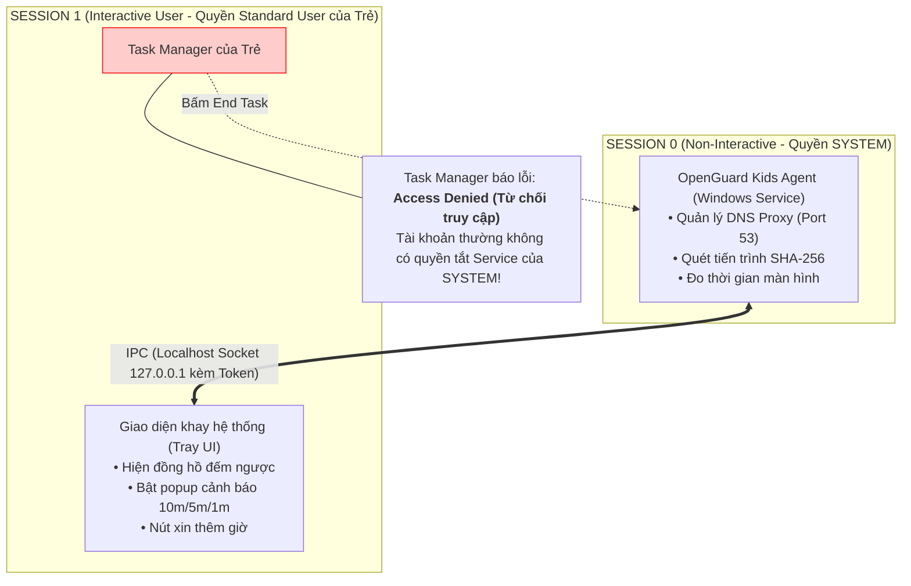

# Chuyên Đề 02: Windows Internals, Session 0 Isolation & Cơ Chế Chống Tắt Ứng Dụng (Anti-Tamper)

> **Môn học:** Mạng Máy Tính & Lập Trình Hệ Thống  
> **Kiến thức trọng tâm:** Cơ chế cách ly Session trong Windows, lập trình Windows Service, bảo vệ tiến trình, và đo thời gian dùng máy thực tế.

---

## 1. Bản Chất Windows Internals: User Space vs. Kernel Space

Hệ điều hành Windows chia bộ nhớ thành hai không gian tách biệt nghiêm ngặt:
1. **Kernel Space (Không gian nhân - Ring 0):** Nơi nhân hệ điều hành (`ntoskrnl.exe`), các trình điều khiển phần cứng (Hardware Drivers) và hệ thống mạng cấp thấp hoạt động. Lỗi ở đây sẽ gây "Màn hình xanh chết chóc" (BSOD).
2. **User Space (Không gian người dùng - Ring 3):** Nơi toàn bộ ứng dụng người dùng chạy (Chrome, Game, Word...). Các ứng dụng này bị cách ly trong không gian địa chỉ ảo của chính mình, không được phép can thiệp trực tiếp vào phần cứng mà phải thông qua **Windows API**.

---

## 2. Bí Quyết Chống Bị Tắt (Anti-Tamper): Cơ Chế Session 0 Isolation

### Vấn đề thực tế:
Nếu phần mềm bảo vệ OpenGuard Kids chỉ là một file `.exe` thông thường chạy khi đứa trẻ đăng nhập:
* Đứa trẻ chỉ cần nhấn tổ hợp phím `Ctrl + Shift + Esc` mở **Task Manager**, chọn tiến trình và nhấn **"End Task"** $\rightarrow$ Phần mềm bị tiêu diệt ngay lập tức!
* Hoặc trẻ mở Command Prompt gõ `taskkill /f /im openguard.exe` $\rightarrow$ Vô hiệu hóa bảo vệ.

### Giải pháp kỹ thuật: Windows Service chạy trong Session 0
Kể từ Windows Vista, Microsoft áp dụng kiến trúc **Session 0 Isolation**:
* **Session 0:** Dành riêng hoàn toàn cho các **Dịch vụ hệ thống ngầm (Windows Services)** chạy dưới tài khoản quyền lực tối cao: `NT AUTHORITY\SYSTEM`. Phiên này **HOÀN TOÀN KHÔNG CÓ GIAO DIỆN ĐỒ HỌA (Non-Interactive)**.
* **Session 1, 2...:** Dành riêng cho người dùng tương tác (Interactive User Desktop) khi đăng nhập vào Windows.



### Tại sao trẻ không thể tắt được Service?
Khi đứa trẻ mở Task Manager và cố bấm "End Task" tiến trình Service trong Session 0:
* Windows kiểm tra mã định danh bảo mật (**SID - Security Identifier**).
* Tiến trình con chạy quyền `Standard User`, trong khi Service chạy quyền `SYSTEM` với đặc quyền bảo vệ dịch vụ `SERVICE_STOP`.
* Hệ điều hành lập tức ném ra thông báo: **"Access is Denied" (Từ chối truy cập)**!

---

## 3. Giao Tiếp Liên Tiến Trình (IPC): Làm sao Session 0 nói chuyện với Session 1?

Vì Session 0 bị cấm hoàn toàn việc hiển thị cửa sổ lên màn hình (để chống tấn công Shatter Attack), nên:
* Service trong Session 0 **KHÔNG THỂ tự hiển thị thông báo popup hay đồng hồ đếm ngược cho đứa trẻ thấy**.
* Ta phải tách kiến trúc làm 2 phần:
  1. **Core Service (Chạy ngầm trong Session 0):** Thực thi việc chặn web, tính giờ, diệt app cấm.
  2. **Tray UI App (Chạy trong Session 1):** Hiển thị icon khay hệ thống và thông báo nhắc nhở cho trẻ.

### Hai thành phần này "nói chuyện" với nhau bằng cách nào?
Chúng sử dụng cơ chế **IPC (Inter-Process Communication) qua Localhost Socket**:
* Service mở một máy chủ HTTP mini lắng nghe tại `127.0.0.1:8765`.
* **Cơ chế xác thực bí mật (Shared Secret Token):**
  * Khi Service khởi động, nó tự tạo một chuỗi khóa bí mật ngẫu nhiên dài 64 ký tự hex.
  * Service ghi khóa này vào file: `C:\ProgramData\OpenGuardKids\ipc_token.key`.
  * Thư mục này được Windows phân quyền ACL: **Chỉ có SYSTEM và Administrators mới được đọc**.
  * Ứng dụng Tray UI khi khởi động sẽ đọc khóa này để gửi kèm vào Header mỗi yêu cầu HTTP (`X-OGK-Token: <token>`).
  * Bất kỳ phần mềm lạ mặt nào gửi lệnh giả mạo tới `127.0.0.1:8765` mà không có Token sẽ bị từ chối `403 Forbidden` ngay lập tức!

---

## 4. Chống Gian Lận Đổi Tên Ứng Dụng Bằng Mã Băm SHA-256 (Process Hashing)

### Lỗ hổng của các phần mềm kiểm soát nghiệp dư:
Nhiều phần mềm phụ huynh chỉ kiểm tra tên file, ví dụ thấy tên `lol.exe` hay `genshin.exe` thì tắt.  
👉 Đứa trẻ chỉ cần vào thư mục game, đổi tên `lol.exe` thành `calculator.exe` (Máy tính) hoặc `winword.exe` (Word) là phần mềm bị "qua mặt" hoàn toàn!

### Giải pháp của OpenGuard Kids:
OpenGuard Kids không bao giờ tin tưởng tên file `.exe`:
1. Khi phát hiện một tiến trình mới khởi chạy qua thư viện `psutil`:
   ```python
   exe_path = proc.exe() # Lấy đường dẫn file nhị phân thực tế
   ```
2. Agent mở file nhị phân đó lên và tính toán **Mã băm SHA-256** của nội dung file:
   ```python
   import hashlib

   def get_file_sha256(file_path):
       hasher = hashlib.sha256()
       with open(file_path, "rb") as f:
           while chunk := f.read(65536): # Đọc từng khối 64KB
               hasher.update(chunk)
       return hasher.hexdigest()
   ```
3. **Nguyên lý toán học của hàm băm một chiều (Kurose & Ross Chương 8):**
   * Cho dù đứa trẻ có đổi tên file thành bất kỳ cái gì, nội dung nhị phân bên trong không đổi $\rightarrow$ **Mã băm SHA-256 hoàn toàn không đổi!**
   * Agent tra mã băm này với danh mục cấm: Nếu trùng mã băm của Game, Agent gọi API hệ thống `proc.terminate()` để tắt ngay lập tức!

---

## 5. Đo Thời Gian Thực Sử Dụng Màn Hình Qua API `GetLastInputInfo`

Đề tài yêu cầu: *"Đo thời gian dùng máy thực tế, tự động trừ thời gian treo máy khi trẻ không ngồi trước màn hình"*.

Nếu chỉ đếm giờ máy bật, khi trẻ đi ăn cơm hoặc đi ngủ mà quên tắt máy, phần mềm sẽ trừ oan hết giờ của trẻ $\rightarrow$ Vi phạm nguyên tắc nhân văn **NT1 & NT3**.

### Hiện thực bằng Windows API:
Hệ điều hành Windows có sẵn một bộ đếm tích tắc từ lúc người dùng chạm tay vào bàn phím hoặc di chuột gần nhất:
```python
import ctypes
import ctypes.wintypes

class LASTINPUTINFO(ctypes.Structure):
    _fields_ = [
        ("cbSize", ctypes.wintypes.UINT),
        ("dwTime", ctypes.wintypes.DWORD)
    ]

def get_idle_duration_seconds():
    user32 = ctypes.windll.user32
    kernel32 = ctypes.windll.kernel32
    
    lii = LASTINPUTINFO()
    lii.cbSize = ctypes.sizeof(LASTINPUTINFO)
    
    # Lấy mốc thời gian của hành động gõ phím/chuột gần nhất
    user32.GetLastInputInfo(ctypes.byref(lii))
    
    # Lấy tổng thời gian máy tính đã bật (uptime ticks)
    millis_since_boot = kernel32.GetTickCount()
    
    # Thời gian rảnh rỗi (Idle) = Hiện tại - Lần bấm phím cuối
    idle_millis = millis_since_boot - lii.dwTime
    return idle_millis / 1000.0
```

### Quy tắc cộng trừ thời gian của OpenGuard Kids:
* Mỗi phút, Agent chạy một vòng lặp kiểm tra:
  * Nếu `get_idle_duration_seconds() > 300` (Tức là hơn 5 phút không hề chạm chuột/phím) $\rightarrow$ **Trạng thái IDLE (Treo máy)**: Đồng hồ đếm ngược ngừng trừ giờ!
  * Nếu trẻ quay lại bấm chuột $\rightarrow$ **Trạng thái ACTIVE (Đang dùng)**: Đồng hồ tiếp tục đếm giờ sử dụng bình thường.

