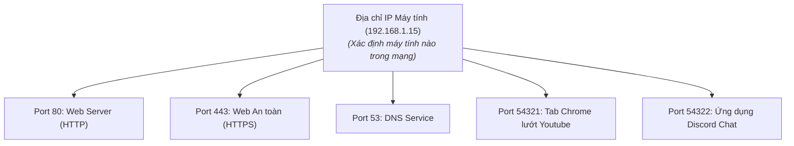
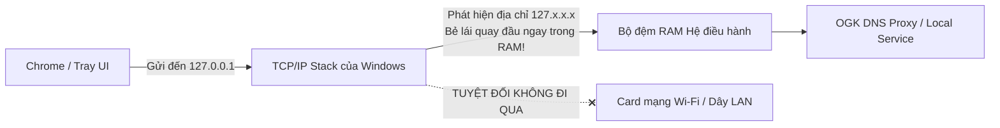

# Chuyên Đề 03: Địa Chỉ Mạng, Cổng (Port), Khái Niệm Socket & Giao Tiếp Loopback

> **Môn học:** Mạng Máy Tính (Chương 2 & 3 Kurose & Ross)  
> **Kiến thức trọng tâm:** Bản chất cổng mạng (Port 16-bit), Socket API, phân biệt 2-tuple (UDP) vs 4-tuple (TCP), và bí mật của địa chỉ Loopback `127.0.0.1`.

---

## 1. Địa Chỉ IP và Cổng (Port): Sự Phân Công Lao Động

Nhiều người mới học thường thắc mắc: *"Đã có địa chỉ IP để tìm ra máy tính rồi, tại sao lại phải sinh ra Cổng (Port) làm gì?"*

Hãy tưởng tượng một trường đại học hoặc một tòa nhà chung cư:
* **Địa chỉ IP:** Giống như **Địa chỉ của Tòa nhà chung cư** (Ví dụ: Số 227 Nguyễn Văn Cừ, Q5). Nó giúp người đưa thư tìm đến đúng tòa nhà giữa thành phố.
* **Cổng (Port Number):** Giống như **Số phòng trong chung cư** (Ví dụ: Phòng 502, Phòng 443). Trên một máy tính có hàng trăm phần mềm chạy cùng lúc (Chrome, Discord, Spotify, Game...). Khi một gói tin bay tới máy tính, hệ điều hành nhờ vào số Port để biết phải gõ cửa giao gói tin cho phần mềm nào!



---

## 2. Bản Chất Toán Học & Phân Vùng Cổng Mạng (Port Numbers)

* Trong tiêu đề của giao thức TCP và UDP (Tầng Giao vận), trường số hiệu cổng có độ dài **16-bit nhị phân**.
* Vì $2^{16} = 65,536$, nên số hiệu cổng trải dài từ **0 đến 65,535**.

Tổ chức IANA phân chia 65,536 cổng này thành 3 nhóm rõ rệt:

| Nhóm Cổng | Dải số hiệu | Mục đích sử dụng | Các cổng kinh điển cần nhớ |
| :--- | :---: | :--- | :--- |
| **Well-Known Ports**<br>(Cổng chuẩn mực) | **0 – 1,023** | Dành riêng cho các dịch vụ cốt lõi của Internet. Trên Linux/Windows, chỉ tài khoản Administrator/root mới có quyền mở các cổng này. | • **Port 53:** DNS (Tên miền)<br>• **Port 80:** HTTP (Web không mã hóa)<br>• **Port 443:** HTTPS (Web bảo mật TLS)<br>• **Port 22:** SSH (Quản trị từ xa)<br>• **Port 67/68:** DHCP (Cấp phát IP)<br>• **Port 123:** NTP (Đồng bộ giờ) |
| **Registered Ports**<br>(Cổng đã đăng ký) | **1,024 – 49,151** | Dành cho các phần mềm của các hãng công nghệ lớn đăng ký với IANA. | • **Port 3306:** MySQL Database<br>• **Port 5432:** PostgreSQL<br>• **Port 8000/8080:** Cổng chạy thử nghiệm Web Server (FastAPI, Flask) |
| **Dynamic / Ephemeral Ports**<br>(Cổng tạm thời) | **49,152 – 65,535** | Hệ điều hành tự động cấp phát ngẫu nhiên cho các ứng dụng phía máy khách (Client) khi mở kết nối ra ngoài, và thu hồi lại khi tắt ứng dụng. | Cổng của các Tab Chrome, Steam, Zoom khi gọi video... |

---

## 3. Khái Niệm Socket API: "Cánh Cửa" Ra Vào Mạng Của Lập Trình Viên

Trong sách Kurose & Ross, **Socket** được định nghĩa bằng một hình tượng kinh điển:
> *"Socket là cánh cửa nằm giữa một Tiến trình Ứng dụng (chạy trong User Space) và Ngăn xếp Mạng TCP/IP (chạy trong Nhân Hệ điều hành)."*

* Lập trình viên không cần biết mạng truyền bằng sóng Wi-Fi hay cáp quang. Lập trình viên chỉ cần tạo một Socket:
  ```python
  import socket
  s = socket.socket(socket.AF_INET, socket.SOCK_DGRAM) # Tạo socket UDP
  s.bind(("127.0.0.1", 53)) # Gắn socket vào Cổng 53
  ```
* Khi muốn gửi dữ liệu: Gọi lệnh `s.sendto()`.
* Khi muốn nhận dữ liệu: Gọi lệnh `s.recvfrom()`.
* Mọi việc đóng gói IP, tính toán MAC, truyền bit... đều do hệ điều hành lo phía sau cánh cửa Socket!

---

## 4. Bí Ẩn: Tại Sao 1 Card Mạng Lại Mở Được Hàng Trăm Tab Chrome Cùng Lúc?

Máy tính của bạn chỉ cắm duy nhất 1 dây mạng và chỉ có **1 địa chỉ IP duy nhất** (Ví dụ `192.168.1.15`).  
Vậy khi bạn mở 50 tab Chrome vào cùng một trang web `youtube.com`:
* Làm sao máy tính không bị "loạn", dữ liệu video của tab số 1 không bao giờ bị nhảy nhầm sang tab số 2?

### Câu trả lời nằm ở khái niệm 4-tuple của kết nối TCP:
Hệ điều hành nhận diện một luồng kết nối TCP không phải chỉ bằng IP, mà bằng một **Bộ tứ định danh duy nhất (4-tuple)**:
$$\text{Kết nối TCP} = (\text{IP Nguồn}, \text{Port Nguồn}, \text{IP Đích}, \text{Port Đích})$$

Khi bạn mở nhiều tab cùng vào YouTube:

| Kết nối | IP Nguồn (Máy bạn) | Port Nguồn (Windows cấp ngẫu nhiên) | IP Đích (YouTube) | Port Đích (HTTPS) | Kết luận của Hệ điều hành |
| :---: | :---: | :---: | :---: | :---: | :--- |
| **Tab 1** | `192.168.1.15` | **51001** | `142.250.190.46` | `443` | Luồng kết nối số 1 |
| **Tab 2** | `192.168.1.15` | **51002** | `142.250.190.46` | `443` | Luồng kết nối số 2 |
| **Tab 3** | `192.168.1.15` | **51003** | `142.250.190.46` | `443` | Luồng kết nối số 3 |

👉 Nhờ số **Port Nguồn tạm thời (Ephemeral Port)** luôn khác nhau, hệ điều hành phân biệt chính xác $100\%$ gói tin nào thuộc về tab nào!

> ⚠️ **So sánh với UDP (2-tuple):**  
> UDP là giao thức phi kết nối (Connectionless). Socket UDP chỉ cần xác định **(IP Đích, Port Đích)** là có thể "bắn" gói tin đi mà không cần bắt tay tạo luồng cố định. Đây chính là lý do DNS dùng UDP vì nó chỉ cần hỏi một câu ngắn và nhận câu trả lời là xong!

---

## 5. Địa Chỉ Loopback `127.0.0.1` (Localhost) Trong RAM Hoạt Động Ra Sao?

Trong bảng phân bổ IPv4, toàn bộ dải địa chỉ `127.0.0.0/8` (từ `127.0.0.1` đến `127.255.255.254`) được dành riêng cho mục đích **Loopback (Vòng lặp cục bộ)**.

### Cơ chế hoạt động của Loopback Interface:
1. Khi một phần mềm (như Chrome) gửi dữ liệu đến IP `127.0.0.1`:
2. Gói tin đi xuống Tầng 3 (Tầng IP) của Windows.
3. Trình điều khiển TCP/IP của Windows nhận ra tiền tố `127.`:
   * **Nó KHÔNG BAO GIỜ đẩy gói tin xuống card mạng vật lý (Card Wi-Fi / Ethernet)!**
   * **Nó KHÔNG BAO GIỜ phát sóng vô tuyến hay xung điện ra ngoài!**
4. Trình điều khiển lập tức copy vùng nhớ chứa gói tin trong RAM và **đưa ngược trở lại hàng đợi nhận** của Tầng Giao vận (Transport Layer) trên chính máy tính đó!



### Tại sao kiến trúc OpenGuard Kids tận dụng tối đa `127.0.0.1`?
* **Độ trễ gần như bằng 0 ($\approx 0.05 \text{ ms}$):** Vì dữ liệu chỉ truyền giữa các ô nhớ RAM với tốc độ hàng chục Gigabyte/giây, không bị trễ mạng cáp quang.
* **Hoạt động ngoại tuyến (Offline):** Ngay cả khi đứa trẻ rút dây mạng, tắt Wi-Fi thì địa chỉ `127.0.0.1` vẫn hoạt động bình thường $\rightarrow$ OpenGuard Kids vẫn kiểm soát máy tính và đếm giờ bình thường!
* **Bảo mật tuyệt đối từ bên ngoài:** Các hacker trên Internet không thể gửi gói tin từ bên ngoài vào địa chỉ `127.0.0.1` của máy bạn, vì các Router trên Internet sẽ tự động hủy ngay bất kỳ gói tin nào có IP đích là `127.x.x.x`.

