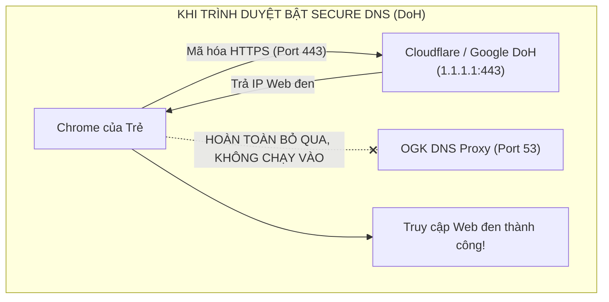
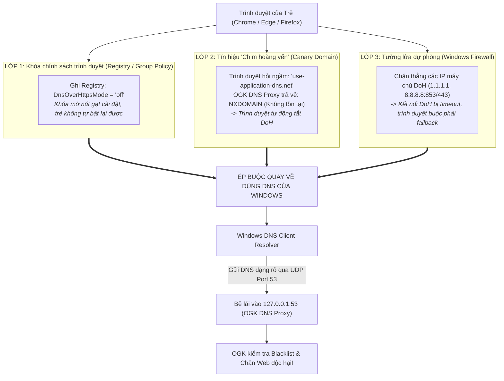
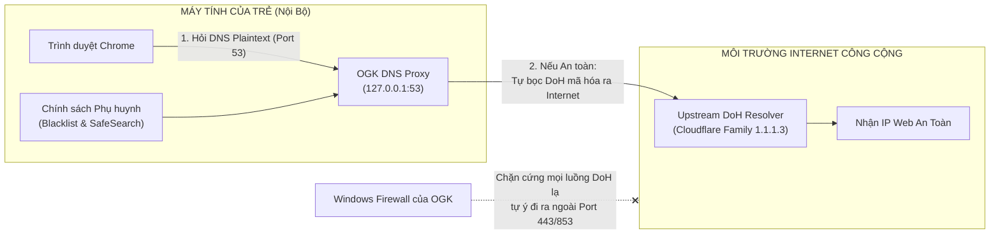

# Chuyên Đề 04: Đi Sâu Giao Thức DNS, Tranh Biện DoH (DNS over HTTPS) & Giải Pháp Kiến Trúc OGK

> **Môn học:** Mạng Máy Tính & An Toàn Thông Tin (Chương 2 & 8 Kurose & Ross)  
> **Kiến thức trọng tâm:** Nguyên lý DNS truyền thống, sự ra đời của DoH/DoT, nghịch lý DoH đối với phần mềm kiểm soát phụ huynh, và kiến trúc "Secure Local Resolver".

---

## 1. Giao Thức DNS Truyền Thống: Nhanh Gọn Nhưng Thiếu An Toàn

Từ những năm 1983, giao thức **DNS (Domain Name System - RFC 1035)** đã đóng vai trò là "danh bạ điện thoại" của Internet:
* Hoạt động chủ yếu trên **UDP Port 53**.
* Thời gian phản hồi cực nhanh (chỉ mất 1 gói tin hỏi và 1 gói tin trả lời).

### Lỗ hổng chết người của DNS truyền thống: Toàn văn dạng rõ (Plaintext)
* Mọi gói tin DNS truyền thống gửi đi đều **hoàn toàn không được mã hóa**.
* Bất kỳ ai nằm trên đường truyền (Chủ quán cà phê Wi-Fi, nhà mạng ISP Viettel/VNPT, hoặc hacker bắt gói tin bằng Wireshark) đều nhìn thấy rõ mồn một:
  * Bạn vừa truy cập trang web nào, đọc báo gì, vào bệnh viện nào tìm kiếm bệnh án...
* **Nguy cơ Tấn công Giả mạo DNS (DNS Poisoning / Spoofing):** Hacker có thể chặn gói tin DNS và trả về một IP giả mạo của trang web ngân hàng để lừa bạn nhập mật khẩu.

---

## 2. Vì Sao Thế Giới Chuyển Sang DoH (DNS over HTTPS) và DoT (DNS over TLS)?

Để bảo vệ quyền riêng tư cá nhân và chống giả mạo, tổ chức IETF đã chuẩn hóa:
1. **DoT (DNS over TLS - RFC 7858):** Bọc gói tin DNS vào kết nối mã hóa TLS trên **Port 853**.
2. **DoH (DNS over HTTPS - RFC 8484):** Bọc câu hỏi DNS thành một yêu cầu HTTP thông thường và gửi qua kênh mã hóa **HTTPS trên Port 443**.

### Lợi ích to lớn của DoH:
* **Chống nghe lén (Eavesdropping):** Không ai ở quán cà phê hay nhà mạng đọc trộm được tên miền bạn đang tra cứu.
* **Chống sửa đổi dữ liệu (Integrity):** Đảm bảo bạn nhận đúng 100% địa chỉ IP chính chủ của máy chủ đích.
* **Ngụy trang hoàn hảo:** Vì DoH dùng chung **Port 443** với mọi lưu lượng duyệt web HTTPS thông thường, các nhà mạng hay tường lửa không thể phân biệt đâu là bạn đang đọc tin tức, đâu là bạn đang tra cứu DNS.

---

## 3. Nghịch Lý Của DoH Đối Với Phần Mềm Kiểm Soát Phụ Huynh

DoH là một bước tiến vĩ đại cho quyền riêng tư cá nhân, nhưng nó lại tạo ra một **cơn ác mộng cho các nhà quản trị mạng trường học và phụ huynh học sinh**!

### Tại sao trẻ dễ dàng dùng DoH để "vượt ngục" vào web đen?
1. Các trình duyệt hiện đại (Google Chrome, Microsoft Edge, Mozilla Firefox) hiện nay đều tích hợp sẵn tính năng mang tên **"Secure DNS" (DNS An toàn)**.
2. Khi bật tính năng này:
   * Trình duyệt **HOÀN TOÀN BỎ QUA** cấu hình DNS của hệ điều hành Windows (`127.0.0.1:53` của OpenGuard Kids)!
   * Trình duyệt tự động mở một luồng kết nối HTTPS mã hóa (Port 443) chạy thẳng ra máy chủ của Google (`https://dns.google/dns-query`) hoặc Cloudflare (`https://cloudflare-dns.com/dns-query`).
3. **Hậu quả:** 
   * Câu hỏi DNS bị mã hóa bằng TLS 1.3 trước khi rời khỏi trình duyệt.
   * Gói tin lướt qua mặt OpenGuard Kids mà phần mềm không thể giải mã hay đọc được tên miền `web-den.com`.
   * Đứa trẻ vô tư truy cập các trang web độc hại mà phần mềm phụ huynh hoàn toàn bị "bịt mắt"!



---

## 4. Cơ Chế 3 Lớp Ngăn Chặn DoH Và Ép Buộc Chuyển Về DNS Truyền Thống

Để vô hiệu hóa hoàn toàn ý định lách luật bằng DoH của trẻ và ép trình duyệt phải quay về dùng bộ phân giải DNS hệ thống tại `127.0.0.1:53`, OpenGuard Kids áp dụng chiến lược **Phòng thủ 3 lớp (Defense-in-Depth)**:



### 🛡️ Lớp 1: Khóa cứng tính năng DoH bằng Windows Registry (Cấp Trình duyệt)
Các trình duyệt hiện đại (Chrome, Edge, Brave, Cốc Cốc) đều dựa trên nhân Chromium và hỗ trợ chính sách quản trị doanh nghiệp (Enterprise Policies):
* Khi Agent chạy quyền `SYSTEM` của Windows Service, nó ghi trực tiếp vào Registry:
  ```text
  HKLM\SOFTWARE\Policies\Google\Chrome\DnsOverHttpsMode = "off"
  HKLM\SOFTWARE\Policies\Microsoft\Edge\DnsOverHttpsMode = "off"
  ```
* **Hiệu quả thực tế:**
  * Nút bật "Use Secure DNS" trong Settings của trình duyệt bị **vô hiệu hóa (xám mờ)**.
  * Hiển thị dòng chữ cảnh báo: *"Cài đặt này do tổ chức của bạn quản lý (Managed by your organization)"*. Trẻ tài khoản thường không thể tự bật lại vì không có quyền Admin.

### 🐤 Lớp 2: Tín hiệu "Chim Hoàng Yến" (Canary Domain - Chuẩn IETF & Mozilla/Chrome)
Đối với các trình duyệt tự động kích hoạt DoH (hoặc Firefox):
* Trước khi chính thức chuyển sang dùng DoH, trình duyệt sẽ gửi một truy vấn DNS truyền thống thăm dò tên miền đặc biệt: `use-application-dns.net`.
* **Cách OGK xử lý:**
  * Khi gói tin hỏi `use-application-dns.net` đi vào `127.0.0.1:53`, OGK lập tức trả về mã lỗi: **`NXDOMAIN` (Non-Existent Domain - Tên miền không tồn tại)**.
* **Phản ứng của trình duyệt:**
  * Khi nhận được `NXDOMAIN`, trình duyệt hiểu rằng mạng này có chính sách quản trị/lọc nội dung của phụ huynh/trường học.
  * Trình duyệt **tự nguyện tắt DoH** và an phận quay về dùng bộ phân giải DNS hệ thống của Windows!

### 🧱 Lớp 3: Tường Lửa Tầng Mạng (Windows Firewall Block) & Cơ chế Fallback
Nếu trẻ tải bản trình duyệt portable không nhận Registry:
* Tường lửa Windows tự động chặn các IP DoH/DoT nổi tiếng (`1.1.1.1`, `8.8.8.8`, `9.9.9.9`) trên cổng 853 (DoT) và cổng 443 (chỉ chặn các IP DoH này, không chặn toàn bộ 443).
* Kết nối DoH bị timeout/từ chối $\rightarrow$ Trình duyệt theo chuẩn RFC bắt buộc phải kích hoạt cơ chế **Fallback (dự phòng)**: quay về gọi hàm DNS mặc định của Windows.

---

## 5. Giải Pháp Kiến Trúc Của OpenGuard Kids: "Secure Local Resolver"

Để giải quyết mâu thuẫn giữa: **"Quyền kiểm soát của phụ huynh"** và **"Bảo mật quyền riêng tư trên Internet"**, OpenGuard Kids áp dụng mô hình kiến trúc chuẩn doanh nghiệp:



### Các bước triển khai kỹ thuật khép kín:
1. **Trình duyệt bị ép về DNS:** Nhờ 3 lớp phòng thủ ở trên, trình duyệt buộc phải gọi `getaddrinfo()`.
2. **Bẻ lái vào Loopback:** Gói tin DNS đi xuống UDP Port 53 $\rightarrow$ IP `127.0.0.1` $\rightarrow$ Đi vào OGK DNS Proxy trong RAM.
3. **Lọc chính sách nội bộ:** Kiểm tra danh mục cấm $\rightarrow$ Sửa CNAME SafeSearch nếu là Google/Bing $\rightarrow$ Trả về Blockpage nếu độc hại.
4. **Bảo mật chiều ra Internet:** Nếu trang web hợp lệ, chính OGK đóng vai trò DoH Client, tự động mã hóa câu hỏi bằng TLS để gửi tới **Cloudflare Family (`1.1.1.3`)**.

> 🎯 **Kết luận thuyết phục bảo vệ đồ án:**  
> Kiến trúc này mang lại lợi ích kép: **Phụ huynh bảo vệ được con ở tầng nội bộ máy tính, trong khi dữ liệu khi bay ra ngoài Internet vẫn được bảo vệ tuyệt đối bằng mã hóa DoH chống nghe lén!**

