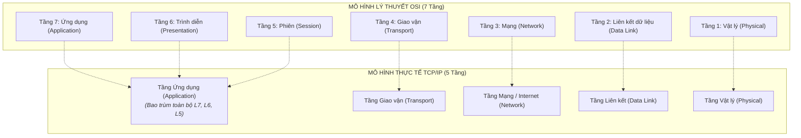

# Chuyên Đề 05: So Sánh Mô Hình OSI (7 Tầng) vs TCP/IP (5 Tầng) & Bản Chất Tầng Ứng Dụng

> **Môn học:** Mạng Máy Tính (Chương 1 & 2 Kurose & Ross)  
> **Kiến thức trọng tâm:** Bảng đối chiếu mô hình tham chiếu, phân tích luồng dữ liệu Facebook, và làm sáng tỏ bản chất của Tầng Ứng dụng.

---

## 1. Bảng Đối Chiếu 2 Mô Hình Mạng: Lý Thuyết OSI vs Thực Tế TCP/IP

Trong lịch sử ngành công nghệ mạng:
* **Mô hình OSI (Open Systems Interconnection):** Do tổ chức tiêu chuẩn hóa ISO đề xuất với **7 tầng**. Đây là mô hình mang tính lý thuyết, phân chia trách nhiệm rất hàn lâm và chặt chẽ.
* **Mô hình TCP/IP (Internet Architecture):** Được xây dựng và phát triển trên thực tế bởi Bộ Quốc phòng Mỹ (ARPANET) và các kỹ sư thực hành. Mô hình này gộp 3 tầng cao nhất của OSI lại thành một tầng duy nhất gọi là **Tầng Ứng dụng (Application Layer)**.



---

## 2. Phân Tích Thực Tế: Ứng Dụng Facebook Hoạt Động Ra Sao Trên Các Tầng?

Khi bạn mở máy tính, bật trình duyệt Chrome và truy cập `https://www.facebook.com`:

### 🔹 Phân tích theo Mô hình 7 tầng OSI:
1. **Tầng 7 (Ứng dụng - Application):** 
   * Trình duyệt soạn thảo yêu cầu HTTP/2 hoặc HTTP/3: `GET /feed` hoặc `POST /api/graphql` khi bạn nhấn Like/Bình luận.
2. **Tầng 6 (Trình diễn - Presentation):** 
   * **Mã hóa:** Gói tin được mã hóa bằng **TLS 1.3** để bảo vệ mật khẩu/tin nhắn.
   * **Nén:** Nén dữ liệu JSON/HTML bằng thuật toán **Brotli/Gzip** để tải trang nhanh hơn.
   * **Định dạng đa phương tiện:** Xử lý ảnh (WebP), video (MP4/H.264).
3. **Tầng 5 (Phiên - Session):** 
   * Quản lý trạng thái đăng nhập qua **Session Cookies** (`c_user`, `xs token`), giúp bạn không phải nhập lại mật khẩu mỗi khi chuyển trang.
   * Duy trì kết nối WebSocket để nhận thông báo (Notification) theo thời gian thực.
4. **Tầng 4 (Giao vận - Transport):** 
   * Dùng **TCP (Port 443)** hoặc **QUIC/UDP**: Đảm bảo gói tin không bị mất, kiểm soát luồng và chống nghẽn mạng (BBR).
5. **Tầng 3 (Mạng - Network):** 
   * Bọc vào **IP Datagram**: IP Nguồn (máy bạn) $\rightarrow$ IP Đích (Máy chủ Facebook/Meta). Định tuyến qua các nhà mạng bằng giao thức BGP.
6. **Tầng 2 (Liên kết - Data Link):** 
   * Bọc vào **Frame Wi-Fi (802.11)** hoặc **Ethernet**: Gán MAC card mạng máy bạn $\rightarrow$ MAC Router Wi-Fi trong nhà. Kiểm tra mã lỗi CRC.
7. **Tầng 1 (Vật lý - Physical):** 
   * Chuyển các bit `0` và `1` thành **sóng vô tuyến 5GHz** hoặc **xung ánh sáng** trong sợi cáp quang biển.

---

## 3. Làm Sáng Tỏ Hiểu Lầm Phổ Biến Về "Tầng Ứng Dụng"

Rất nhiều sinh viên nhầm lẫn rằng: *"Tầng ứng dụng là nơi chạy toàn bộ phần mềm như Word, Chrome, Game"*.

### Thực tế được phân định rạch ròi:
* **Ứng dụng phần mềm người dùng (Application Software):** Giao diện đồ họa (UI), nút bấm, engine xử lý JavaScript V8, dựng hình 3D... là **phần mềm nội bộ** chạy trong bộ nhớ của máy tính dưới sự điều khiển của hệ điều hành, **KHÔNG THUỘC TẦNG MẠNG NÀO CẢ**.
* **Giao thức Tầng Ứng dụng (Application-Layer Protocol):** Chỉ là **bộ quy tắc và định dạng thông điệp** mà ứng dụng dùng để trao đổi dữ liệu với máy khác qua mạng (Ví dụ: cú pháp `GET / HTTP/1.1`, mã phản hồi `200 OK`, cấu trúc JSON RPC).

> 📌 **Định nghĩa của Kurose & Ross:**  
> *"Giao thức tầng ứng dụng định nghĩa cách các tiến trình chạy trên các hệ thống đầu cuối khác nhau trao đổi thông điệp với nhau."*

### Các giao thức Tầng Ứng dụng "vô hình" chạy ngầm:
Người dùng không mở giao diện để bấm chuột vào chúng, nhưng chúng vẫn là giao thức Tầng Ứng dụng 100%:
* **DNS (Port 53):** Dịch vụ tra cứu tên miền thành IP (chạy trên UDP).
* **DHCP (Port 67/68):** Tự động xin cấp phát địa chỉ IP cho máy tính (chạy trên UDP).
* **NTP (Port 123):** Tự động đồng bộ giờ hệ thống với máy chủ nguyên tử.

---

## 4. Quá Trình Hai Chiều: Đóng Gói (Encapsulation) vs Mở Gói (Decapsulation)

Quá trình truyền thông mạng luôn diễn ra theo 2 chiều đối xứng tuyệt đối:

```mermaid
sequenceDiagram
    autonumber
    actor User as Người dùng
    participant App as Tầng 5: Ứng dụng (Data/Message)
    participant Trans as Tầng 4: Giao vận (Segment/Port)
    participant Net as Tầng 3: Mạng (Packet/IP)
    participant Link as Tầng 2: Liên kết (Frame/MAC)
    participant Phy as Tầng 1: Vật lý (Bits/Signals)

    Note over User,Phy: CHIỀU GỬI (Bắt đầu tại Tầng Ứng dụng - Đi từ TRÊN XUỐNG)
    User->>App: Bấm gửi tin nhắn
    App->>Trans: Tạo Message -> Đẩy qua Socket API
    Trans->>Net: Bọc thêm Port (TCP/UDP Header)
    Net->>Link: Bọc thêm IP (IP Header)
    Link->>Phy: Bọc thêm MAC (Frame Header + CRC Trailer)
    Phy->>Phy: Bắn ra sóng vô tuyến / Xung điện

    Note over Phy,User: CHIỀU NHẬN (Kết thúc tại Tầng Ứng dụng - Đi từ DƯỚI LÊN)
    Phy->>Link: Thu nhận tín hiệu -> Chuyển thành chuỗi bit
    Link->>Net: Kiểm tra CRC -> Bóc bỏ lớp vỏ MAC
    Net->>Trans: Đọc IP đúng là mình -> Bóc bỏ lớp vỏ IP
    Trans->>App: Đọc Port đúng -> Ráp nối dữ liệu -> Bóc lớp vỏ TCP
    App->>User: Nhận nội dung sạch -> Hiển thị tin nhắn lên màn hình
```

