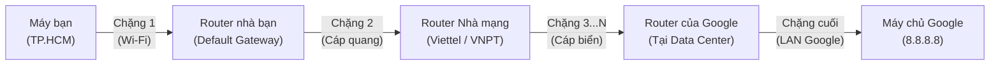

# Chuyên Đề 06: Địa Chỉ IP (Tầng 3) vs Địa Chỉ MAC (Tầng 2) & Cơ Chế Định Tuyến Tìm Đường

> **Môn học:** Mạng Máy Tính (Chương 4 & 5 Kurose & Ross)  
> **Kiến thức trọng tâm:** Phân biệt IP (Toàn trình) vs MAC (Từng chặng), giao thức ARP, cách máy tính tìm đường (Subnet Mask) và Router tìm đường (BGP/OSPF/Longest Prefix Match).

---

## 1. Bản Chất Khác Biệt: Địa Chỉ IP vs. Địa Chỉ MAC

| Đặc tính | Địa chỉ IP (Tầng 3 - Network) | Địa chỉ MAC (Tầng 2 - Data Link) |
| :--- | :--- | :--- |
| **Bản chất** | Địa chỉ logic toàn cầu (Ví dụ: `8.8.8.8`) | Địa chỉ vật lý phần cứng ghi chết trên chip card mạng |
| **Phạm vi** | **Toàn trình (End-to-End):** Không đổi từ máy bạn đến máy chủ đích | **Từng chặng (Hop-by-Hop):** Chỉ có giá trị trong 1 chặng mạng LAN, bị thay mới sau mỗi Router |
| **Hình tượng thực tế** | **Địa chỉ nhà ghi trên bưu kiện:** • Gửi từ: Nhà bạn ở TP.HCM • Gửi đến: Tòa nhà Google ở California | **Biển số xe của anh shipper từng chặng:** • Chặng 1: Xe máy từ nhà ra bưu cục quận. • Chặng 2: Xe tải bưu cục ra sân bay. • Chặng 3: Máy bay chở hàng sang Mỹ. |

---

## 2. Bí Ẩn: Tại Sao Gói Tin Đi Khỏi Máy Lại KHÔNG CÓ MAC Của Máy Chủ Google?

Nhiều người thắc mắc: *"Tôi gửi gói tin đến máy chủ Google, tại sao trong Frame lại ghi MAC Đích là Cục Router nhà tôi?"*

### Lý do vật lý:
* Card mạng Wi-Fi của máy tính chỉ có tầm phủ sóng vài chục mét trong nhà bạn. Nó **hoàn toàn không thể bắn sóng vô tuyến trực tiếp sang tận nước Mỹ** để card mạng của máy chủ Google nghe thấy!
* Thiết bị duy nhất có dây nối hoặc bắt sóng trực tiếp với máy bạn để dẫn đường ra thế giới là **Router nhà bạn (Default Gateway)**.
* Do đó, máy bạn chỉ cần ném gói tin cho Router nhà. Địa chỉ MAC đích ở chặng đầu tiên chính là **MAC của Router nhà bạn**.

### Bảng theo dõi cặp MAC biến đổi qua từng chặng:

| Chặng đường | IP Nguồn & IP Đích (Tầng 3) | MAC Nguồn & MAC Đích (Tầng 2) |
| :--- | :--- | :--- |
| **Chặng 1:** Máy bạn $\rightarrow$ Router nhà | • Src IP: Máy bạn • Dst IP: `8.8.8.8` | • Src MAC: **Card Wi-Fi máy bạn** • Dst MAC: **Router nhà bạn** |
| *(Router nhà bóc Frame cũ, dán Frame mới)* | *(IP Đích vẫn là `8.8.8.8`)* | |
| **Chặng 2:** Router nhà $\rightarrow$ Router Viettel | • Src IP: Máy bạn (hoặc Public IP) • Dst IP: `8.8.8.8` | • Src MAC: **Cổng WAN Router nhà** • Dst MAC: **Cổng Router Viettel** |
| *(Qua hàng chục Router trung gian...)* | *(Vẫn giữ nguyên Dst IP `8.8.8.8`)* | *(Cứ qua mỗi Router, cặp MAC lại được thay mới)* |
| **Chặng cuối:** Router Google $\rightarrow$ Server Google | • Src IP: Máy bạn • Dst IP: `8.8.8.8` | • Src MAC: **Router Google** • Dst MAC: **Card mạng Máy chủ Google** |

👉 **Chỉ ở chặng cuối cùng nằm bên trong phòng máy chủ của Google, MAC của máy chủ Google mới thực sự xuất hiện!**

---

## 3. Giao Thức ARP (Address Resolution Protocol): Làm Sao Biết MAC Của Router?

Khi máy tính vừa bật lên, nó chỉ biết IP của Router (Ví dụ `192.168.1.1`). Làm sao nó biết địa chỉ MAC vật lý của Router?
1. Máy bạn phát loa hét to toàn bộ mạng LAN (**Broadcast**):  
   *"Ai đang giữ IP `192.168.1.1` thì trả lời cho tôi biết địa chỉ MAC!"*
2. Router nghe thấy sẽ gửi trả lời riêng (**Unicast**):  
   *"Là tôi đây, MAC của tôi là `FC:D7:33:AA:BB:CC`"*.
3. Máy bạn lưu thông tin này vào **Bảng nhớ tạm ARP (ARP Cache)**.  
   *(Bạn có thể mở CMD trên Windows gõ lệnh `arp -a` để xem bảng này)*.

---

## 4. Cách Gói Tin Tìm Đường: 2 Cấp Độ Định Tuyến

### 📍 Cấp độ 1: Tại máy tính của bạn (Phép toán Subnet Mask)
Máy tính tự hỏi: *"IP Đích này ở cùng phòng (LAN) hay ở ngoài thế giới (Internet)?"*
* Máy tính lấy IP Đích thực hiện phép toán nhị phân logic `AND` với **Subnet Mask**:
  * Nếu kết quả **TRÙNG** với mạng nhà mình $\rightarrow$ Thiết bị nội bộ (Máy in, máy đứa em) $\rightarrow$ Hỏi ARP gửi trực tiếp!
  * Nếu kết quả **KHÁC** $\rightarrow$ Ở ngoài Internet $\rightarrow$ Tra Bảng định tuyến (`route print`), dòng `0.0.0.0/0` chỉ định ném thẳng cho **Default Gateway** (Router nhà).

### 📍 Cấp độ 2: Giữa biển Router trên Internet (Bảng chuyển tiếp & BGP)
Router đứng ở ngã tư đường, tra cứu **Bảng chuyển tiếp (Forwarding Table)**:
* Khi gói tin tới, Router đọc IP đích và đối chiếu các dải mạng trong sổ.
* **Nguyên tắc Khớp tiền tố dài nhất (Longest Prefix Match):** Dải mạng nào cụ thể và chi tiết nhất (Prefix dài nhất) sẽ được ưu tiên chọn để chuyển tiếp.
* **Ai cập nhật sổ tay cho Router?**
  * Trong nội bộ một nhà mạng: Dùng giao thức **OSPF** (thuật toán tìm đường ngắn nhất Dijkstra).
  * Giữa các tập đoàn toàn cầu (Viettel, Google, Cloudflare): Dùng giao thức **BGP (Border Gateway Protocol)**.

