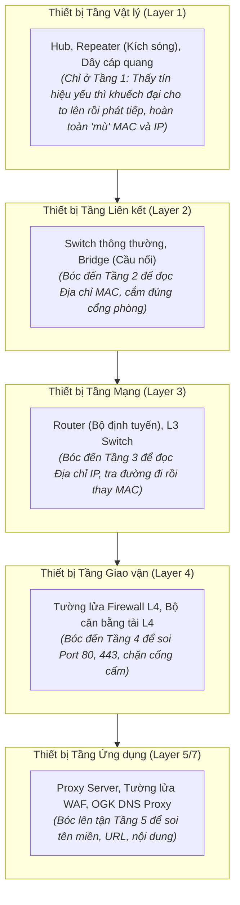

# Chuyên Đề 07: Quy Tắc Phân Tầng Thiết Bị Mạng & Giới Hạn Xử Lý Tại Từng Hop

> **Môn học:** Mạng Máy Tính (Chương 1 & 4 Kurose & Ross)  
> **Kiến thức trọng tâm:** Quy tắc vàng phân loại thiết bị mạng, cấu tạo hoạt động của Switch/Router, và 3 lý do sống còn vì sao Router trung gian không bao giờ bóc lên Tầng 4/5.

---

## 1. Quy Tắc Vàng Của Thiết Bị Mạng (The Golden Rule)

> 📌 **Định nghĩa chuẩn mực:**  
> **"Một thiết bị mạng mang danh Tầng N thì nó chỉ bóc gói tin lên tới Tầng N để xử lý, sau đó lập tức đóng gói ngược lại đi xuống Tầng 1 để đẩy sang trạm kế tiếp."**

* **Thiết bị đầu cuối (End System / Host):** Máy tính, điện thoại, máy chủ web (Chạy đủ cả 5 tầng từ Vật lý lên Ứng dụng).
* **Thiết bị trung gian (Network Intermediary Devices):** Chỉ chạy đến đúng tầng chức năng của nó.

---

## 2. Bảng Phân Cấp Chi Tiết Các Thiết Bị Mạng

| Loại thiết bị | Tầng cao nhất nó chạm tới | Dữ liệu nó đọc hiểu | Hành động cụ thể |
| :--- | :---: | :--- | :--- |
| **Hub / Repeater** (Kích sóng Wi-Fi) | **Tầng 1** (Vật lý) | Tín hiệu điện áp / Sóng vô tuyến. Hoàn toàn không biết MAC hay IP. | Thấy sóng Wi-Fi trong nhà yếu $\rightarrow$ Thu sóng lại, kích cho biên độ sóng mạnh lên rồi phát tán ra xung quanh. |
| **Switch** (Bộ chia cổng mạng LAN) | **Tầng 2** (Liên kết dữ liệu) | Đọc được **Địa chỉ MAC**. Hoàn toàn "mù" địa chỉ IP. | Nhận bit (T1) $\rightarrow$ Lên Tầng 2 đọc **MAC Đích** $\rightarrow$ Tra bảng MAC Table xem cắm ở cổng số mấy $\rightarrow$ Đẩy xuống T1 ném ra đúng cổng đó. |
| **Router** (Bộ định tuyến) | **Tầng 3** (Mạng) | Đọc được **Địa chỉ IP** và **Địa chỉ MAC**. | Lên T1 $\rightarrow$ T2 $\rightarrow$ T3 đọc **IP Đích** $\rightarrow$ Tra bảng chuyển tiếp $\rightarrow$ Giảm TTL đi 1 $\rightarrow$ Xuống T2 dán MAC mới $\rightarrow$ T1 phát đi. |
| **Tường lửa (Firewall) L4** | **Tầng 4** (Giao vận) | Đọc được **Cổng (Port)** và cờ trạng thái TCP (SYN/ACK). | Thấy gói tin gửi đến Port 22 (SSH từ xa) hoặc Port 23 (Telnet) $\rightarrow$ Hủy gói tin ngay lập tức. |
| **Proxy / DNS Proxy** | **Tầng 5** (Ứng dụng) | Bóc sạch từ T1 lên đến tận Tầng 5. | Đọc được nội dung câu hỏi DNS hoặc yêu cầu HTTP để lọc tên miền và nội dung độc hại. |

---

## 3. Vì Sao Router Trung Gian TUYỆT ĐỐI KHÔNG Bóc Lên Tầng 4 Và Tầng 5?

Nếu mỗi Router trung gian trên thế giới đều bóc gói tin lên Tầng 5 rồi lại đóng gói xuống, mạng Internet toàn cầu sẽ sụp đổ ngay vì 3 nguyên nhân cốt tử:

### ① Tốc độ xử lý bằng phần cứng (Hardware ASIC Speed)
* Router trục chính của nhà mạng phải xử lý **hàng trăm Terabit dữ liệu mỗi giây** (hàng tỷ gói tin/giây).
* Việc đọc IP Tầng 3 được thực hiện bằng **chip phần cứng chuyên dụng (ASIC / FPGA)** trong vài phần tỷ giây (nanoseconds).
* Nếu phải giải nén Tầng 4 (ráp nối các mảnh TCP) và đọc Tầng 5 (đọc HTTP/JSON) bằng CPU phần mềm, Router sẽ nghẽn và quá nhiệt ngay lập tức.

### ② Tính bảo mật & Mã hóa dữ liệu (TLS 1.3 Encryption)
* Toàn bộ dữ liệu Tầng 5 của người dùng đã bị mã hóa bằng **TLS 1.3 (HTTPS)** trước khi rời máy tính.
* Đối với các Router trên đường đi, Tầng 5 chỉ là một chuỗi ký tự ngẫu nhiên vô nghĩa (ciphertext). Router có tò mò bóc lên cũng **hoàn toàn không thể đọc hiểu được** nội dung!

### ③ Triết lý Điểm - Đầu - Cuối (The End-to-End Principle)
* **Lõi mạng (Mạng lưới Router):** Càng đơn giản, càng "ngu ngơ" càng tốt — Nhiệm vụ duy nhất là chuyển phát nhanh gói tin dựa trên IP.
* **Biên mạng (Máy tính người dùng và Máy chủ):** Là nơi đặt sự thông minh — Xử lý logic nghiệp vụ, mã hóa, giải mã.
* Nhờ triết lý này, các kỹ sư phần mềm có thể phát minh ra các ứng dụng mới như **Zoom, ChatGPT, TikTok, Web3** mà **không cần phải xin phép hay nâng cấp bất kỳ chiếc Router nào trên toàn cầu!**

