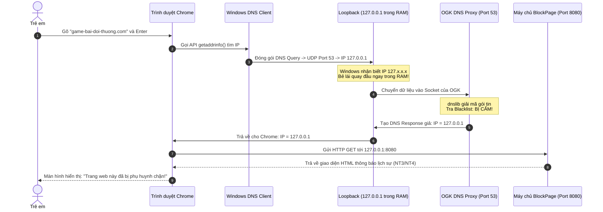
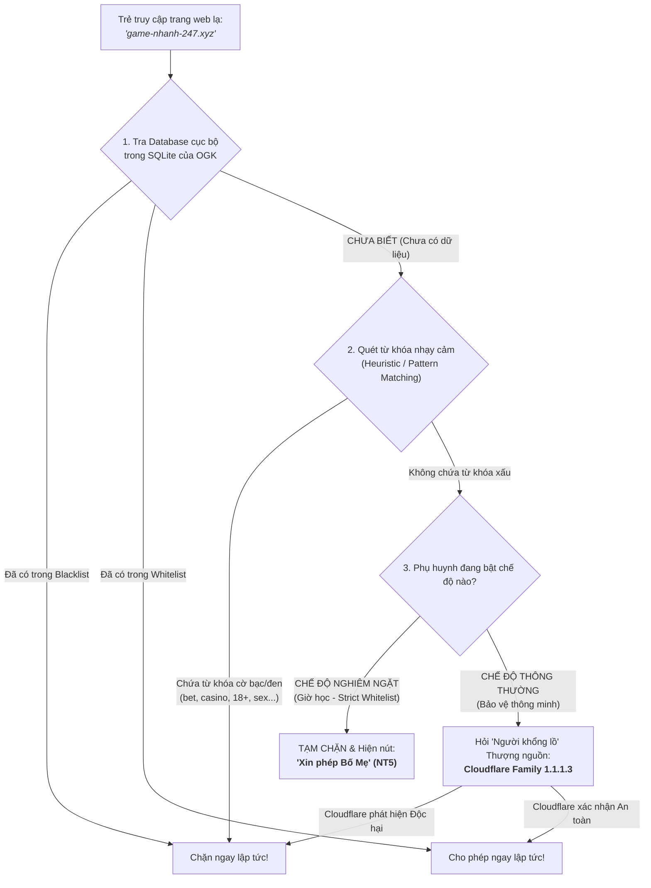

# Chuyên Đề 08: Vòng Đời Một Tên Miền Khi Nhập Vào Trình Duyệt Trong Môi Trường OpenGuard Kids

> **Môn học:** Mạng Máy Tính & Hiện Thực Hóa Đồ Án  
> **Kiến thức trọng tâm:** Tường thuật chi tiết từng mili-giây hành trình của một tên miền qua các tầng mạng, cơ chế DNS Sinkhole/Blockpage, SafeSearch CNAME rewrite, và chuyển tiếp Upstream sạch.

---

## 1. Trạng Thái Chuẩn Bị Của Hệ Thống (Pre-Conditions)

Trước khi đứa trẻ mở trình duyệt, ứng dụng OpenGuard Kids đã được cài đặt và vận hành ngầm trên Windows:
1. **Card mạng (Wi-Fi/LAN Adapter):** Đã được cấu hình địa chỉ DNS chính (Preferred DNS) trỏ về **`127.0.0.1` (Loopback)** bằng lệnh tự động `netsh interface ip set dns`.
2. **Tiến trình Lõi `OpenGuardService` (Session 0):**
   * Đang mở một UDP Socket lắng nghe tại cổng **`127.0.0.1:53`** (Module DNS Proxy).
   * Đang nạp sẵn Danh mục cấm (Blacklist) từ SQLite Database vào bộ đệm RAM Cache.
3. **Máy chủ Web Cảnh báo (BlockPage HTTP Server):** Đang chạy lắng nghe tại **`127.0.0.1:8080`**.

---

## 2. Kịch Bản 1: Đứa Trẻ Vào Trang Web Bị Cấm (`game-bai-doi-thuong.com`)

### Tường thuật chi tiết từng bước:
1. **$0.0 \text{ ms}$ (Tầng 5 - Chrome):** Đứa trẻ gõ tên miền và nhấn Enter. Trình duyệt chưa có IP trong cache nên gọi hàm hệ thống `getaddrinfo("game-bai-doi-thuong.com")`.
2. **$0.2 \text{ ms}$ (Tầng 4 & 3 - Windows TCP/IP):** Windows đóng gói **DNS Query** vào **UDP Datagram** (Port đích 53) và bọc ngoài bằng **IP Packet** (IP đích `127.0.0.1`).
3. **$0.4 \text{ ms}$ (Tầng 2 & 1 - Bẻ lái Loopback):** Nhận ra IP `127.0.0.1`, Windows **không đưa ra card Wi-Fi**, mà bẻ lái quay đầu trực tiếp trong bộ đệm RAM.
4. **$0.8 \text{ ms}$ (Tầng 5 - OGK DNS Proxy):** Hàm `socket.recvfrom()` của OGK nhận chuỗi byte nhị phân. Thư viện `dnslib` bóc gói tin, đọc ra tên miền `game-bai-doi-thuong.com`.
5. **$1.0 \text{ ms}$ (Kiểm tra chính sách):** Tra cứu bảng cấm trong RAM Cache $\rightarrow$ **KẾT QUẢ: TÊN MIỀN BỊ CẤM!**
6. **$1.2 \text{ ms}$ (Phản hồi giả lập - DNS Sinkhole):** OGK tự đóng gói một thông điệp DNS Response: Trả về IP **`127.0.0.1`** (hoặc `0.0.0.0`).
7. **$2.0 \text{ ms}$ (Kết nối Blockpage):** Trình duyệt Chrome nhận được IP `127.0.0.1`, liền gửi yêu cầu HTTP GET đến `127.0.0.1:8080`.
8. **$3.5 \text{ ms}$ (Hiển thị thân thiện):** Máy chủ web mini của OGK trả về trang giao diện HTML hòa nhã:  
   *"Trang web này không phù hợp với thời gian học tập của bạn. Hãy trao đổi với bố mẹ nếu cần truy cập."* (Tuân thủ nguyên tắc sư phạm **NT3 & NT4**).
9. **Ghi nhật ký ngầm:** OGK ghi một bản ghi vào SQLite:  
   `INSERT INTO web_events (domain, action, timestamp) VALUES ('game-bai-doi-thuong.com', 'BLOCKED', 1772098000)`.

---

## 3. Kịch Bản 2: Đứa Trẻ Vào Trang Web Hợp Lệ (`khanacademy.org`)

Khi đứa trẻ truy cập trang học tập được phép:

1. **Bước 1-4:** Gói tin DNS vẫn đi vào `127.0.0.1:53` của OGK như trên.
2. **Bước 5 (Kiểm tra chính sách):** Tra cứu Blacklist $\rightarrow$ **HỢP LỆ (Không nằm trong danh mục cấm)**.
3. **Bước 6 (Chuyển tiếp ra Internet - Upstream Forwarding):**
   * OGK đóng vai trò là một DNS Forwarder: Gửi gói tin câu hỏi này ra ngoài Internet tới máy chủ DNS sạch ở thượng nguồn (Ví dụ: **Cloudflare Family `1.1.1.3`** hoặc Google DNS `8.8.8.8`).
   * Gói tin lúc này mới thực sự đi qua đầy đủ 5 tầng mạng: T5 $\rightarrow$ UDP $\rightarrow$ IP $\rightarrow$ Frame Wi-Fi $\rightarrow$ Sóng vô tuyến $\rightarrow$ Router nhà $\rightarrow$ Cáp quang biển $\rightarrow$ Cloudflare.
4. **Bước 7 (Nhận IP thật):** Cloudflare trả về IP thật của Khan Academy (Ví dụ `104.18.22.45`).
5. **Bước 8 (Trả về cho Chrome):** OGK lưu IP này vào bộ nhớ đệm (DNS Cache) và trả về cho Chrome.
6. **Bước 9 (Bắt đầu duyệt Web):** Lúc này, trình duyệt Chrome mới chính thức:
   * Mở kết nối **TCP 3-way handshake** (Port 443) tới `104.18.22.45`.
   * Bắt tay mã hóa **TLS 1.3**.
   * Tải toàn bộ video bài giảng về cho trẻ học bình thường.

---

## 4. Kịch Bản 3: Ép Buộc Tìm Kiếm An Toàn (SafeSearch CNAME Rewrite)

Khi đứa trẻ vào công cụ tìm kiếm như **Google** hay **Bing**:
* Nếu tìm kiếm hình ảnh, có thể vô tình xuất hiện các hình ảnh không phù hợp lứa tuổi.
* **Giải pháp kỹ thuật của OGK:**
  * Khi OGK phát hiện câu hỏi DNS hỏi tên miền `google.com` hoặc `www.google.com`:
  * OGK không trả về IP bình thường của Google, mà **viết lại bản ghi CNAME** trỏ về:  
    👉 **`forcesafesearch.google.com`** (Địa chỉ máy chủ an toàn chính thức của Google dành cho trường học).
  * Nhờ đó, máy chủ của Google sẽ **tự động bật chế độ lọc nghiêm ngặt (Strict SafeSearch)**, che mờ và loại bỏ 100% hình ảnh độc hại trước khi gửi về máy tính của trẻ!

---

## 5. Kịch Bản 4: Xử Lý Tên Miền Mới / Lạ / Chưa Rõ An Toàn (Unclassified Domains)

Mỗi ngày trên thế giới có hàng trăm ngàn tên miền mới sinh ra. Nếu đứa trẻ truy cập vào một trang web lạ (ví dụ: `game-nhanh-247.xyz` hoặc `tailieu-onthi-2026.net`) mà **chưa hề có trong cơ sở dữ liệu SQLite cục bộ của OGK**, hệ thống sẽ xử lý qua **Quy trình phân loại 4 cấp**:

### 1. Cấp 1: Kiểm tra Biểu thức Chính quy (Heuristic / Keyword Matching)
* Dù chưa từng gặp tên miền này, OGK dùng bộ lọc Regex quét qua chuỗi ký tự tên miền:
  * Nếu chứa các từ khóa cờ bạc, nội dung người lớn, bạo lực (ví dụ: `*bet88*`, `*casino*`, `*xxx*`, `*hack-game*`, `*free-robux*`...) $\rightarrow$ **Phân loại ngay là ĐỘC HẠI và CHẶN TỨC THÌ!**

### 2. Cấp 2: Tận dụng Trí tuệ Nhân tạo Thượng nguồn (Cloudflare 1.1.1.3)
* Nếu tên miền không chứa từ khóa xấu rõ ràng: OGK chuyển tiếp câu hỏi lên **Cloudflare Family (`1.1.1.3`)** hoặc **CleanBrowsing Family**.
* Cloudflare sở hữu hệ thống Threat Intelligence toàn cầu cập nhật theo từng giây. Nếu máy chủ Cloudflare nhận diện đó là trang web lừa đảo (Phishing), mã độc (Malware) mới sinh $\rightarrow$ Cloudflare sẽ tự trả về `0.0.0.0` giúp OGK chặn đứng mối đe dọa.

### 3. Cấp 3: Chế độ "Giờ Học Nghiêm Ngặt" (Strict Whitelist — Default Deny)
* Nếu phụ huynh đang bật chế độ giờ học (ví dụ từ 19:30 đến 21:30): Mọi tên miền lạ không nằm trong danh mục học tập đều bị **TẠM CHẶN**.
* Màn hình hiển thị giải thích lịch sự kèm **Nút bấm "GỬI YÊU CẦU XIN PHÉP PHỤ HUYNH" (Nguyên tắc NT5)**.
* Khi trẻ bấm nút, một thông báo được gửi ngay qua WebSocket về Parent Dashboard để bố mẹ bấm Duyệt từ xa chỉ trong 2 giây!

---

## 6. Tổng Kết Vấn Đáp Đồ Án (Defense FAQ)

> ❓ **Giảng viên hỏi:** *"Tại sao nhóm lại chọn can thiệp ở tầng DNS mà không dùng phương pháp bắt toàn bộ gói tin (Packet Sniffing / WinDivert) ở Tầng 2 hoặc Tầng 3?"*  
> 
> 💡 **Nhóm sinh viên tự tin trả lời:**  
> 1. **Hiệu năng vượt trội (Performance):** Bắt và giải mã toàn bộ lưu lượng mạng ở Tầng 2/3 đòi hỏi cài đặt Kernel Driver phức tạp, ngốn CPU và dễ làm chậm tốc độ mạng của máy tính. Trong khi DNS chỉ xử lý các gói tin rất nhỏ ở thời điểm bắt đầu mở trang web.
> 2. **Chặn ngay từ 'trứng nước':** Chặn tại DNS giúp triệt tiêu kết nối trước khi máy tính kịp tốn bất kỳ tài nguyên nào để bắt tay 3 bước TCP hay đàm phán mã hóa TLS với trang web độc hại.
> 3. **An toàn tuyệt đối cho hệ điều hành:** Hoạt động hoàn toàn ở User Space (Layer 5), không can thiệp sâu vào Kernel Driver nên không bao giờ gây lỗi màn hình xanh (BSOD) hay làm treo máy tính của người dùng!

