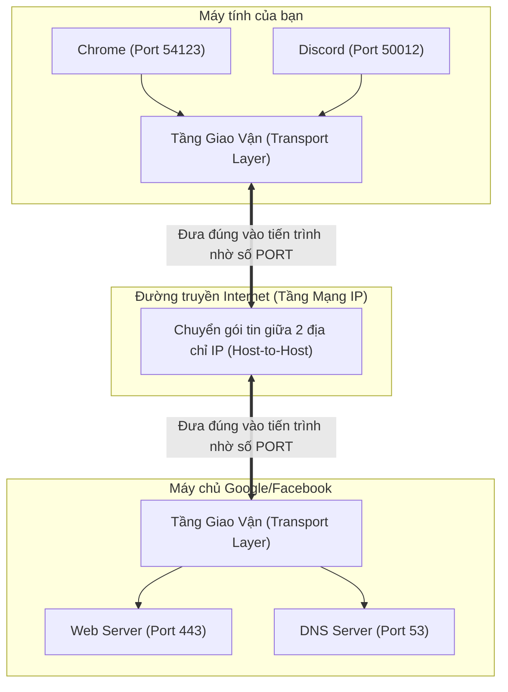
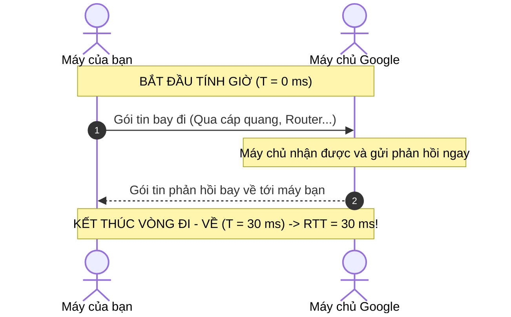
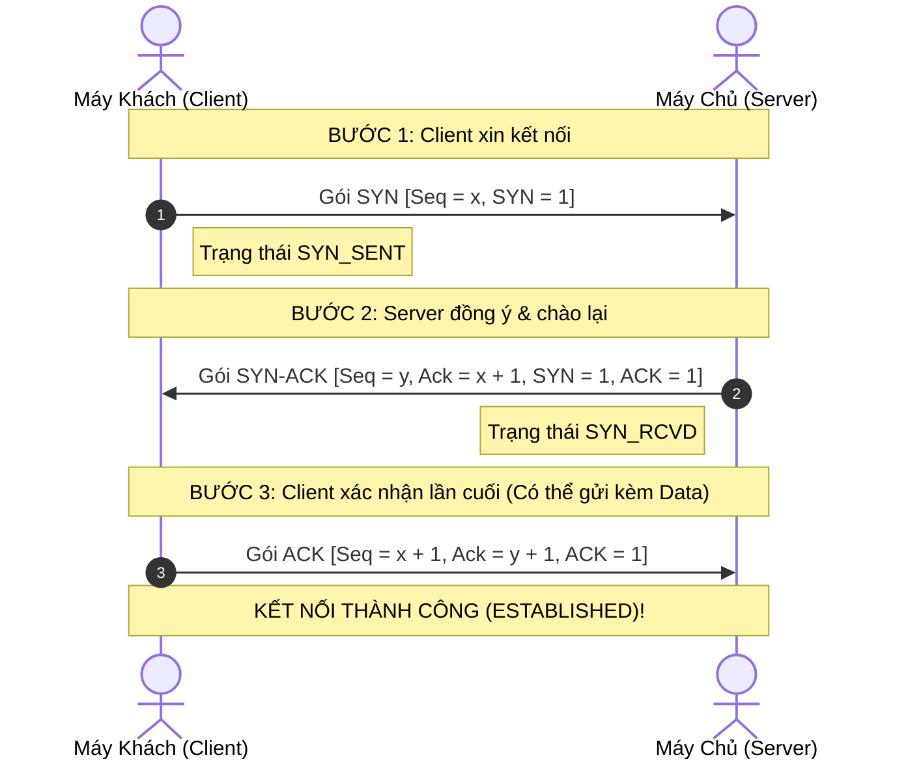
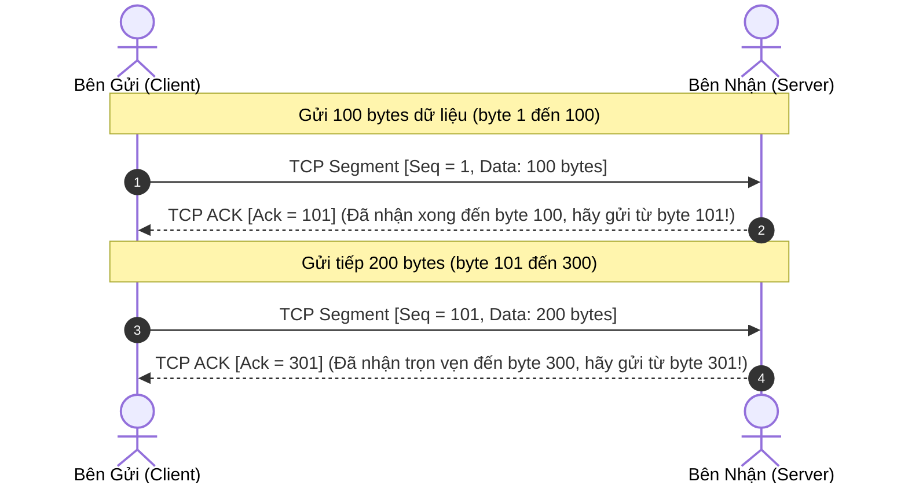

# Chuyên Đề 09: Đi Sâu Tầng Giao Vận (Transport Layer) — TCP Handshake, RTT, Segment vs. Datagram & Kiểm Soát Nghẽn

> **Môn học:** Mạng Máy Tính (Chương 3 Kurose & Ross)  
> **Kiến thức trọng tâm:** Khái niệm RTT, cấu trúc gói tin UDP Datagram (8B) vs TCP Segment (20B), bắt tay 3 bước (3-way handshake), cơ chế RDT (Seq & Ack), kiểm soát luồng vs kiểm soát nghẽn, và lý do lựa chọn UDP/TCP trong OpenGuard Kids.

---

## 1. Tầng Giao Vận (Transport Layer) Làm Gì?

Trong mô hình mạng, sự phân công giữa Tầng Mạng và Tầng Giao Vận được định nghĩa rất chặt chẽ:
* **Tầng Mạng (IP):** Chịu trách nhiệm chuyển gói tin từ **Máy tính này sang Máy tính kia** (*Host-to-Host*).
* **Tầng Giao Vận (TCP/UDP):** Chịu trách nhiệm chuyển giao dữ liệu từ **Tiến trình phần mềm này sang Tiến trình phần mềm kia** (*Process-to-Process*) thông qua số hiệu **Cổng (Port)**.



Tầng giao vận có 2 giao thức rường cột mang 2 triết lý trái ngược:
1. **UDP (User Datagram Protocol):** "Nhanh - Nhẹ - Vô tư" (Không bắt tay, không đảm bảo nhận đủ, gửi xong là thôi).
2. **TCP (Transmission Control Protocol):** "Cẩn thận - Trách nhiệm - Đáng tin cậy" (Bắt tay đàng hoàng, mất gói thì gửi lại, tự kiểm soát nghẽn).

---

## 2. RTT Là Gì? (Round Trip Time - Thời Gian Vòng Đi - Về)

**RTT (Round Trip Time)** là **tổng thời gian tính từ lúc một gói tin rời máy gửi, bay qua môi trường mạng tới máy đích, cho đến khi tín hiệu phản hồi từ máy đích bay ngược về tới máy gửi**. Đơn vị đo là **mili-giây (ms)**.



### Ý nghĩa sống còn của RTT trong giao thức mạng:
1. **Tính toán thời gian Timeout của TCP:** TCP không dùng một con số cố định để đếm giờ mất gói. Nó liên tục đo RTT thực tế của từng gói tin và tính toán thời gian chờ động:
   $$\text{Timeout} = \text{EstimatedRTT} + 4 \times \text{DevRTT}$$
   Nếu RTT đo được là $30\text{ ms}$, TCP sẽ đặt đồng hồ khoảng $150\text{ ms}$. Quá thời gian này chưa thấy Ack $\rightarrow$ Tự động gửi lại!
2. **Chi phí thời gian (0-RTT vs 1-RTT):**
   * **UDP:** Không cần bắt tay, gửi dữ liệu ngay từ gói tin đầu tiên $\rightarrow$ Tốn **0-RTT**.
   * **TCP:** Phải mất 1 vòng đi-về bắt tay (`SYN` $\rightarrow$ `SYN-ACK`) trước khi gửi được byte dữ liệu đầu tiên $\rightarrow$ Tốn **1-RTT**.

---

## 3. Gói Tin Của UDP: UDP Datagram (Header 8 Bytes)

* **Triết lý:** Tối giản đến mức tối đa.
* Tiêu đề (Header) của UDP chỉ vỏn vẹn đúng **8 Bytes (64 bits)** chia đều cho **4 trường**:

```text
 0                   1                   2                   3
 0 1 2 3 4 5 6 7 8 9 0 1 2 3 4 5 6 7 8 9 0 1 2 3 4 5 6 7 8 9 0 1
+-+-+-+-+-+-+-+-+-+-+-+-+-+-+-+-+-+-+-+-+-+-+-+-+-+-+-+-+-+-+-+-+
|       Source Port (16 bits)   |    Destination Port (16 bits) |
+-+-+-+-+-+-+-+-+-+-+-+-+-+-+-+-+-+-+-+-+-+-+-+-+-+-+-+-+-+-+-+-+
|          Length (16 bits)     |       Checksum (16 bits)      |
+-+-+-+-+-+-+-+-+-+-+-+-+-+-+-+-+-+-+-+-+-+-+-+-+-+-+-+-+-+-+-+-+
|                                                               |
|          DỮ LIỆU TẦNG ỨNG DỤNG (APPLICATION PAYLOAD)          |
|                 (Ví dụ: Gói tin DNS Query)                    |
|                                                               |
+-+-+-+-+-+-+-+-+-+-+-+-+-+-+-+-+-+-+-+-+-+-+-+-+-+-+-+-+-+-+-+-+
```

1. **Source Port (16 bits):** Cổng ứng dụng trên máy gửi (ví dụ: `54123`).
2. **Destination Port (16 bits):** Cổng ứng dụng trên máy nhận (ví dụ: `53` cho DNS).
3. **Length (16 bits):** Tổng chiều dài gói (tính cả 8 bytes header + dữ liệu).
4. **Checksum (16 bits):** Mã băm kiểm tra lỗi toàn vẹn bit trong quá trình truyền.

> 📌 **Tại sao gọi là "Datagram"?**  
> Mỗi gói UDP là một thực thể độc lập tự thân (*self-contained*), giống như một bức bưu thiếp. Các gói không hề biết nhau, không có số thứ tự, gửi đi theo kiểu "bắn và quên" (*fire-and-forget*).

---

## 4. Gói Tin Của TCP: TCP Segment (Header 20–60 Bytes)

* **Triết lý:** Đầy đủ tiện nghi, an toàn tuyệt đối.
* Tiêu đề (Header) của TCP tối thiểu là **20 Bytes** (gấp 2.5 lần UDP), và có thể lên tới 60 Bytes nếu có thêm tùy chọn (Options).

```text
 0                   1                   2                   3
 0 1 2 3 4 5 6 7 8 9 0 1 2 3 4 5 6 7 8 9 0 1 2 3 4 5 6 7 8 9 0 1
+-+-+-+-+-+-+-+-+-+-+-+-+-+-+-+-+-+-+-+-+-+-+-+-+-+-+-+-+-+-+-+-+
|       Source Port (16 bits)   |    Destination Port (16 bits) |
+-+-+-+-+-+-+-+-+-+-+-+-+-+-+-+-+-+-+-+-+-+-+-+-+-+-+-+-+-+-+-+-+
|                        Sequence Number (32 bits)              |
+-+-+-+-+-+-+-+-+-+-+-+-+-+-+-+-+-+-+-+-+-+-+-+-+-+-+-+-+-+-+-+-+
|                    Acknowledgment Number (32 bits)            |
+-+-+-+-+-+-+-+-+-+-+-+-+-+-+-+-+-+-+-+-+-+-+-+-+-+-+-+-+-+-+-+-+
| HLEN  | Reserved|U|A|P|R|S|F|         Receive Window          |
| (4b)  | (3 bits)|R|C|S|S|Y|I|            (16 bits)            |
|       |         |G|K|H|T|N|N|                                 |
+-+-+-+-+-+-+-+-+-+-+-+-+-+-+-+-+-+-+-+-+-+-+-+-+-+-+-+-+-+-+-+-+
|       Checksum (16 bits)      |     Urgent Pointer (16 bits)  |
+-+-+-+-+-+-+-+-+-+-+-+-+-+-+-+-+-+-+-+-+-+-+-+-+-+-+-+-+-+-+-+-+
|                    Options (Nếu có, 0 - 40 bytes)             |
+-+-+-+-+-+-+-+-+-+-+-+-+-+-+-+-+-+-+-+-+-+-+-+-+-+-+-+-+-+-+-+-+
|                                                               |
|          DỮ LIỆU TẦNG ỨNG DỤNG (APPLICATION PAYLOAD)          |
|             (Ví dụ: Lệnh WebSocket, Web HTML...)              |
|                                                               |
+-+-+-+-+-+-+-+-+-+-+-+-+-+-+-+-+-+-+-+-+-+-+-+-+-+-+-+-+-+-+-+-+
```

### Các trường vũ khí của TCP:
1. **Sequence Number (32 bits):** Đánh số thứ tự byte dữ liệu đầu tiên trong Segment. Giúp bên nhận ráp lại dữ liệu chuẩn xác dù gói tin bay đến lộn xộn.
2. **Acknowledgment Number (32 bits):** Báo nhận tích lũy (Cumulative Ack) — Cho biết bên nhận đang chờ đợi byte số mấy tiếp theo.
3. **Các cờ điều khiển (Flags):**
   * **`SYN`:** Xin mở kết nối.
   * **`ACK`:** Báo nhận thành công.
   * **`FIN`:** Xin đóng kết nối nhẹ nhàng.
   * **`RST`:** Hủy kết nối khẩn cấp (Reset).
4. **Receive Window (`rwnd` - 16 bits):** Báo cho bên gửi biết bộ đệm RAM của bên nhận còn trống bao nhiêu byte (phục vụ **Kiểm soát luồng**).

> 📌 **Tại sao gọi là "Segment"?**  
> Vì ứng dụng nhìn dữ liệu như một dòng chảy liên tục (Byte Stream). TCP sẽ "chặt khúc" dòng chảy này thành các phân đoạn nhỏ (*Segments*) vừa vặn với kích thước mạng (MSS - Maximum Segment Size, thường là 1460 bytes).

---

## 5. Bắt Tay 3 Bước Của TCP (3-Way Handshake)



### ❓ Vì sao bắt buộc phải là 3 bước mà không phải 2 bước?
* **Bài toán gói tin lạc đường (Old Duplicate SYN):** Nếu gói tin SYN số 1 bị nghẽn mạng nửa tiếng sau mới tới Server:
  * Nếu chỉ có 2 bước: Server nhận được SYN cũ tưởng là kết nối mới, liền gửi SYN-ACK và **lập tức mở Socket, tốn RAM chờ đợi**. Trong khi Client đã tắt máy từ lâu $\rightarrow$ Server bị cạn kiệt tài nguyên (SYN Flood).
  * Nhờ có bước thứ 3: Server đợi xác nhận cuối của Client. Khi Client nhận được SYN-ACK của yêu cầu cũ, nó biết là gói rác nên gửi cờ `RST` để hủy ngay, Server không bị tốn tài nguyên oan!

---

## 6. Truyền Tin Tin Cậy (RDT): Sequence Number & Cumulative ACK



### Cách TCP giải quyết mất gói:
1. **Timeout Timer:** Hết thời gian chờ mà chưa có Ack $\rightarrow$ Tự động gửi lại.
2. **Fast Retransmit (Truyền lại nhanh):** Nếu gói số 2 bị mất mà các gói sau vẫn đến, bên nhận gửi liên tục **3 lần Ack trùng nhau (3 Duplicate ACKs)** cho gói 2. Bên gửi nhận 3 Ack trùng sẽ gửi lại gói 2 ngay lập tức mà không cần đợi đồng hồ Timeout đếm hết!

---

## 7. Kiểm Soát Luồng (Flow Control) vs. Kiểm Soát Nghẽn (Congestion Control)

| Đặc điểm | Kiểm Soát Luồng (Flow Control) | Kiểm Soát Nghẽn (Congestion Control) |
| :--- | :--- | :--- |
| **Bảo vệ ai?** | **Bảo vệ BÊN NHẬN (Receiver)** | **Bảo vệ MẠNG INTERNET (Router ở giữa)** |
| **Nguyên nhân** | Máy gửi bắn quá nhanh làm tràn bộ đệm RAM máy nhận. | Hàng đợi tại các Router trung gian bị đầy làm rớt gói tin. |
| **Vũ khí** | Cửa sổ trượt bên nhận (**`rwnd`** - Receive Window). | Cửa sổ nghẽn bên gửi (**`cwnd`** - Congestion Window). |

### Các giai đoạn kinh điển của Kiểm soát nghẽn:
1. **Slow Start (Khởi đầu chậm):** Tăng tốc độ theo cấp số nhân ($1 \rightarrow 2 \rightarrow 4 \rightarrow 8 \rightarrow 16 \dots$ gói).
2. **Congestion Avoidance (Tránh nghẽn - AIMD):** Khi chạm ngưỡng an toàn, chuyển sang tăng từ từ từng gói một ($+1$ mỗi vòng RTT).
3. **Multiplicative Decrease (Giảm cấp số nhân):** Khi phát hiện mất gói $\rightarrow$ Cắt giảm ngay tốc độ xuống **một nửa (/2)** để nhường đường cho mạng phục hồi.

---

## 8. Đóng Kết Nối 4 Bước (TCP Teardown) & Trạng Thái `TIME_WAIT`

Vì TCP là kênh truyền thông **Hai chiều độc lập (Full-Duplex)**, việc đóng kết nối cần 4 bước:
1. Client gửi `FIN` $\rightarrow$ Server gửi `ACK` (Chiều Client $\rightarrow$ Server đóng).
2. Server gửi nốt dữ liệu dở dang $\rightarrow$ Server gửi `FIN` $\rightarrow$ Client gửi `ACK` (Chiều Server $\rightarrow$ Client đóng).

### Tại sao Client phải đứng đợi ở `TIME_WAIT` (thường là 2 phút)?
* Để đảm bảo gói `ACK` cuối cùng đến tay Server an toàn (nếu rơi, Server gửi lại `FIN` thì Client vẫn còn sống để trả lời).
* Để các gói tin cũ còn sót lại trôi nổi trên mạng tự tiêu hủy hết (hết hạn TTL), không gây lẫn lộn vào kết nối mới sau này.

---

## 9. Ứng Dụng Thực Chiến Trong Đồ Án OpenGuard Kids

| Thành phần trong OGK | Giao thức Tầng 4 | Lý do thiết kế kiến trúc | Đoạn mã nguồn |
| :--- | :---: | :--- | :--- |
| **DNS Proxy** | **UDP** | Truy vấn tên miền chỉ gồm 1 câu hỏi và 1 câu trả lời. UDP không tốn thời gian bắt tay (0-RTT), tốc độ phản hồi cực nhanh $< 1\text{ ms}$, không tốn RAM duy trì trạng thái kết nối. | `socket(socket.AF_INET, socket.SOCK_DGRAM)` |
| **WebSocket Dispatcher & Parent Dashboard** | **TCP** | Các lệnh khẩn cấp của cha mẹ (*"Khóa máy ngay lập tức"*) và báo cáo nhật ký tuyệt đối không được phép mất mát hay sai lệch dù chỉ 1 byte. Cần kết nối tin cậy, có Sequence Number và kiểm soát luồng. | `socket(socket.AF_INET, socket.SOCK_STREAM)` |

