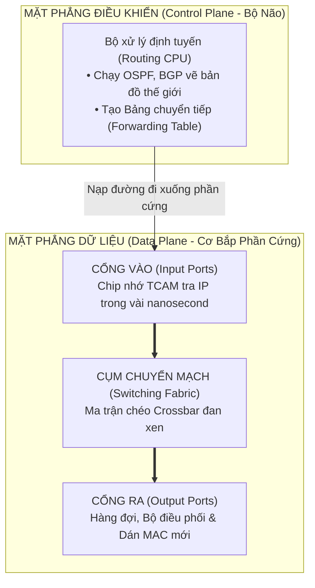
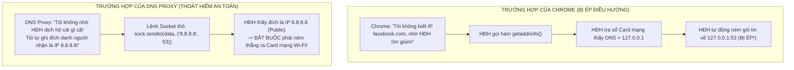

# Chuyên Đề 10: Cơ Chế Bên Trong Router, Bản Chất DNS Proxy, Bí Ẩn Cổng 53 & Kỹ Thuật Bẻ Gãy Vòng Lặp Loopback

> **Môn học:** Mạng Máy Tính & Lập Trình Hệ Thống (Chương 2, 3 & 4 Kurose & Ross)  
> **Kiến thức trọng tâm:** Cấu trúc phần cứng Router (Data Plane vs Control Plane, TCAM, Crossbar), công nghệ 9Router AI, bản chất Proxy & Port 53, giải mã nghịch lý Loopback không bị lặp vô tận, và đường đi vật lý qua Card mạng.

---

## 1. Cơ Chế Hoạt Động Bên Trong Của Một Chiếc Router (What's Inside a Router?)

Theo Mục 4.2 giáo trình chuẩn của Kurose & Ross, một Router không phải là một chiếc máy tính thông thường, mà nó được chia thành **2 mặt phẳng** và **4 thành phần phần cứng chuyên dụng**:



### Bốn bộ phận phần cứng cốt lõi:
1. **Cổng Vào (Input Ports):** Nhận tín hiệu điện/quang (T1) $\rightarrow$ Bóc lớp vỏ MAC (T2) $\rightarrow$ Giảm `TTL` đi 1 $\rightarrow$ Dùng chip nhớ chuyên dụng **TCAM (Ternary Content Addressable Memory)** tra cứu IP đích theo nguyên tắc *Longest Prefix Match* chỉ trong $1$ chu kỳ xung nhịp (vài nanosecond)!
   * *Hiện tượng nghẽn HOL (Head-of-the-Line Blocking):* Gói tin đầu hàng đợi bị kẹt khiến tất cả các gói tin phía sau bị tắc nghẽn theo.
2. **Cụm Chuyển Mạch (Switching Fabric):** "Đường cao tốc" nối Cổng Vào với Cổng Ra. Hiện đại nhất là **Ma trận chéo (Crossbar Switch)** cho phép nhiều gói tin di chuyển song song cùng lúc mà không bị đâm va.
3. **Cổng Ra (Output Ports):** Chứa hàng đợi bộ đệm (Queue). Nếu dữ liệu đổ về quá nhanh làm tràn bộ đệm $\rightarrow$ **Xảy ra hiện tượng Rơi gói tin (Packet Loss / Buffer Overflow)**. Bộ điều phối (*Packet Scheduler*) dùng thuật toán FIFO hoặc Priority Queuing để ưu tiên gói tin nhạy cảm độ trễ (VoIP/Game) đi trước.
4. **Bộ Xử Lý Định Tuyến (Routing Processor / CPU):** Chạy hệ điều hành mạng (Cisco IOS, Linux) và các thuật toán OSPF/BGP.

> 📌 **Phân biệt Router nhà vs Router trục chính:**  
> • **Router gia đình (Home Router):** Là thiết bị *All-in-One* tích hợp 4-trong-1 (Router L3 + Switch L2 + Điểm phát Wi-Fi + Máy chủ cấp DHCP/NAT).  
> • **Router trục chính (Core Router):** To như chiếc tủ lạnh 2 cánh, không có Wi-Fi, không cấp DHCP, chỉ chuyên trách một việc duy nhất: định tuyến hàng trăm Terabit/giây qua cáp quang biển.

---

## 2. Mở Rộng: Công Nghệ "9Router" (AI Router) Là Gì?

**9Router** (`decolua/9router`) là một công cụ mã nguồn mở nổi tiếng trên GitHub đóng vai trò là một **Smart AI Gateway / Reverse Proxy** chạy cục bộ (`http://localhost:20128`):
* **Lấy cảm hứng từ Router mạng:** Thay vì định tuyến gói tin IP theo BGP, 9Router định tuyến các **yêu cầu AI (Prompts / API Calls)** từ các công cụ lập trình (Cursor, Claude Code, Cline, Antigravity) tới hơn 60+ nhà cung cấp AI (OpenAI, Claude, Gemini, DeepSeek, Groq...).
* **Các tính năng đột phá:**
  1. *Unified API Gateway:* Chuẩn hóa mọi định dạng API (OpenAI $\leftrightarrow$ Claude $\leftrightarrow$ Gemini).
  2. *Token Saver (RTK & Caveman Engine):* Tự động nén `git diff`, log kiểm thử, kết quả terminal giúp giảm từ **20% đến 65% chi phí token**.
  3. *Multi-Account Round-Robin:* Xoay vòng nhiều tài khoản miễn phí để không bao giờ bị dính Rate Limit.
  4. *3-Tier Auto-Fallback:* Nếu nhà cung cấp chính bị lỗi 429/500, tự động bẻ lái yêu cầu sang mô hình dự phòng mà không làm gián đoạn IDE của coder.

---

## 3. Bản Chất Của Proxy, DNS Và "DNS Proxy"

* **Proxy (Người đại diện / Máy chủ trung gian):** Là một chương trình đứng ở giữa Client và Server thật để tiếp nhận, kiểm tra, sửa đổi hoặc chuyển tiếp yêu cầu.
* **DNS (Domain Name System):** Là giao thức mạng thuộc **Tầng Ứng dụng (Layer 5/7)** chuyên dịch tên miền chữ (`facebook.com`) thành địa chỉ số IP (`157.240.x.x`).
* **DNS Proxy (Máy chủ Trung gian Giao thức DNS):** Là một tiến trình phần mềm Tầng Ứng dụng đứng gác cổng ngay trên máy, tiếp nhận toàn bộ các gói tin DNS, thực thi logic nghiệp vụ (kiểm tra Blacklist, cưỡng chế SafeSearch) rồi mới quyết định trả lời tại chỗ hay chuyển tiếp ra ngoài Internet.

---

## 4. Bí Ẩn Cổng 53 (Port 53) & Sự Phân Cấp Khách - Chủ

### 1. Tại sao lại là số 53?
IANA đã quy định **Port 53 là số hiệu chuẩn quốc tế bất di bất dịch cho dịch vụ DNS** từ năm 1983. Mọi phần mềm trên thế giới muốn hỏi tên miền đều mặc định gõ cửa Port 53.

### 2. Port 53 chạy trên UDP hay TCP?
* **UDP Port 53 (99%):** Tra cứu lướt web hàng ngày, hỏi 1 câu đáp 1 câu, gói tin nhỏ $< 512$ bytes, đạt tốc độ 0-RTT siêu nhanh.
* **TCP Port 53 (1%):** Dùng khi dữ liệu trả lời vượt quá 512 bytes (chữ ký số DNSSEC) hoặc khi đồng bộ toàn bộ vùng cơ sở dữ liệu tên miền giữa các máy chủ (*Zone Transfer*).

### 3. Phân biệt: Cổng Của Server vs Cổng Của Client
* **Server (DNS Proxy `127.0.0.1:53` hoặc Google `8.8.8.8:53`):** Sở hữu **Cổng 53 CỐ ĐỊNH** đứng im chờ khách.
* **Client (Trình duyệt Chrome):** **TUYỆT ĐỐI KHÔNG CÓ PORT 53!**  
  Chrome chỉ là khách hàng, mỗi khi hỏi đường nó được Windows cấp một **Cổng tạm thời ngẫu nhiên** (ví dụ `Port 54123`). Nó dùng cổng này để gửi tới Port 53 và nhận câu trả lời rồi đóng cổng.

### 4. Hai Căn Phòng Cùng Số "53" Nhưng Khác Nhau Hoàn Toàn:
* **`127.0.0.1:53` (Port 53 của chúng ta):** Căn phòng số 53 tại ngôi nhà Localhost trong RAM máy bạn.
* **`8.8.8.8:53` (Port 53 của Google):** Căn phòng số 53 tại tòa nhà Data Center của Google bên Mỹ.
* Vì gắn với 2 địa chỉ IP khác nhau trên 2 cỗ máy khác nhau, chúng **hoàn toàn không xung đột**!

---

## 5. Giải Mã Nghịch Lý: Vì Sao OGK Không Bị Rơi Vào Vòng Lặp Vô Tận (Infinite Loop)?

### ❓ Nghịch lý đặt ra:
*"Cả máy tính đã bị cấu hình DNS = `127.0.0.1:53`. Khi OGK gặp một trang web an toàn mà nó chưa biết IP, tại sao khi nó đi hỏi thì Hệ điều hành không ép gói tin quay ngược về chính nó?"*

### 💡 Lời giải đáp kỹ thuật:
Sự khác biệt cốt tử nằm ở **Cách gọi hàm lập trình**:



1. **Chrome bị ép** vì nó dùng tên chữ (`facebook.com`) và giao phó toàn bộ quyền cho Windows. Windows giở sổ cấu hình thấy `127.0.0.1` nên ném về nhà.
2. **DNS Proxy không bị ép** vì nó **không gọi hàm tra cứu của Windows**. Nó tự mở Socket và **chỉ định đích danh một địa chỉ IP số cụ thể ngoài Internet: `8.8.8.8` (hoặc `1.1.1.3`)**.
3. Vì `8.8.8.8` bản thân nó đã là một địa chỉ IP, Windows không cần và không có quyền tra cứu DNS nữa, mà bắt buộc phải ném thẳng gói tin ra ngoài card mạng!

---

## 6. Đường Đi Vật Lý Đầy Đủ Của Gói Tin Ra Internet

Về mặt vật lý, một đoạn code Python trong RAM không có ăng-ten để phát sóng. Quá trình truyền tin ra Google ngoài Internet diễn ra qua chuỗi 6 mắt xích phần cứng:

```text
[Phần mềm Python OGK (RAM)]
            | Gọi lệnh sock.sendto(data, ("8.8.8.8", 53))
            v
[Trình điều khiển TCP/IP của Windows (Kernel)]
            | Đóng gói IP Header (Dst: 8.8.8.8), tra Routing Table
            v
[Card Mạng Vật Lý (Card Wi-Fi / Cáp LAN)]
            | Bọc địa chỉ MAC Router nhà, biến bit thành sóng vô tuyến 5GHz
            v
[Cục Router Wi-Fi Nhà Bạn (Default Gateway)]
            | Chuyển sóng vô tuyến thành xung ánh sáng trong sợi cáp quang
            v
[Biển Internet & Cáp Quang Biển Quốc Tế (Viettel/VNPT -> AAG/APG)]
            v
[Máy Chủ Google DNS (8.8.8.8 : Cổng 53)]
```

* **Lưu ý quan trọng:** Chiếc **Card mạng phần cứng (NIC)** là thiết bị Tầng 1/2. Nó hoàn toàn "mù chữ" đối với cấu hình DNS phần mềm `127.0.0.1` của Windows. Khi nhận lệnh từ hệ điều hành bảo bắn ra ăng-ten, Card mạng cứ thế bắn sóng vô tuyến ra ngoài không khí mà không bao giờ chặn hay bắt gói tin quay đầu!

---

## 7. Phân Cấp Quyền Lực: Ai Lớn Nhất Trong Máy Tính?

* **Hệ Điều Hành Windows (Nhà Vua Tối Cao):** Cai quản toàn bộ tài nguyên phần cứng, CPU, RAM, Card mạng và cấp phát Port.
* **OpenGuard Kids Service (Viên Quan Đại Thần):** Chạy dưới tài khoản tối cao **`NT AUTHORITY\SYSTEM`** trong Session 0. Được "Nhà Vua" cấp đặc quyền:
  * Độc quyền sở hữu **Port 53**.
  * Quyền sửa đổi cấu hình Card mạng.
  * Quyền miễn nhiễm trước lệnh tắt Task Manager của người dùng thường.
* **Đứa trẻ & Trình duyệt Chrome (Thường dân):** Không có quyền Admin, bị trói buộc và phải tuân thủ $100\%$ mọi chính sách do OpenGuard Kids đặt ra!

